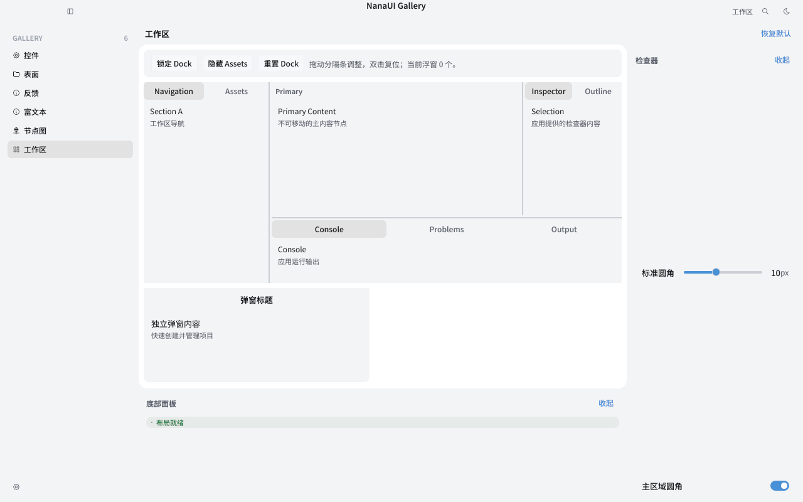
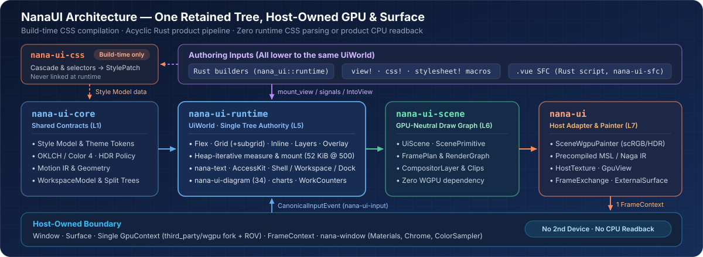
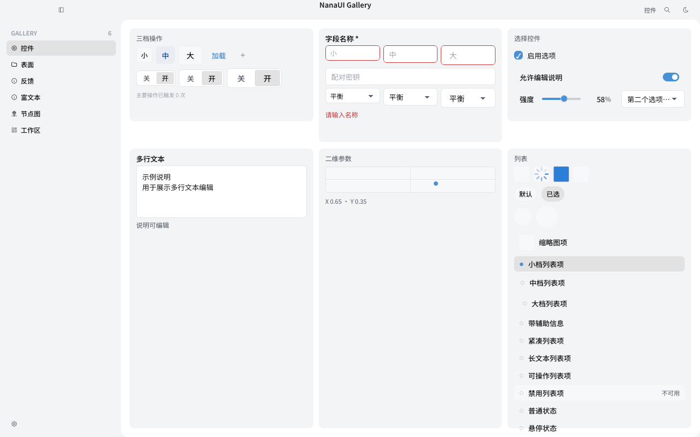
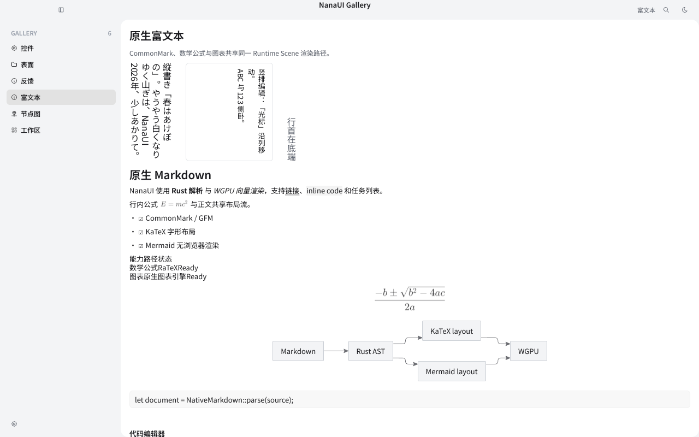
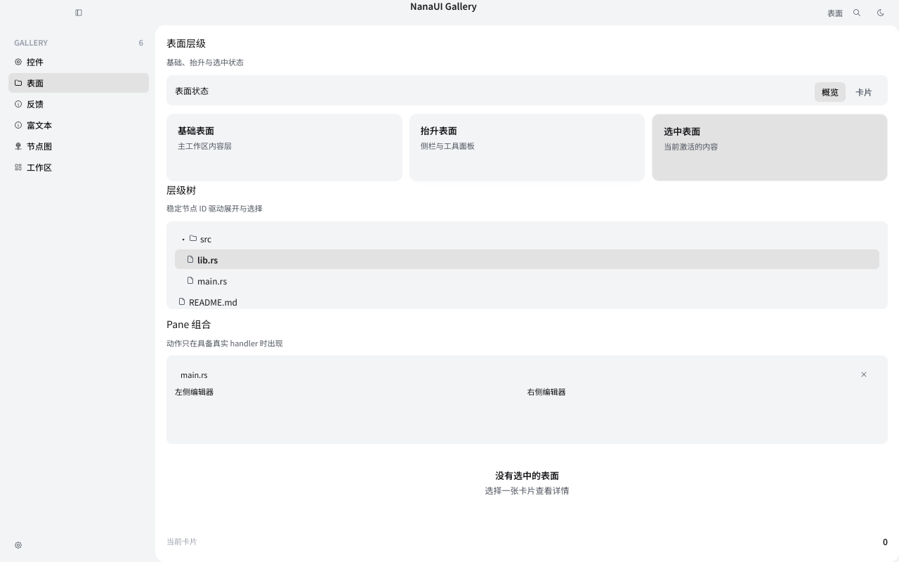
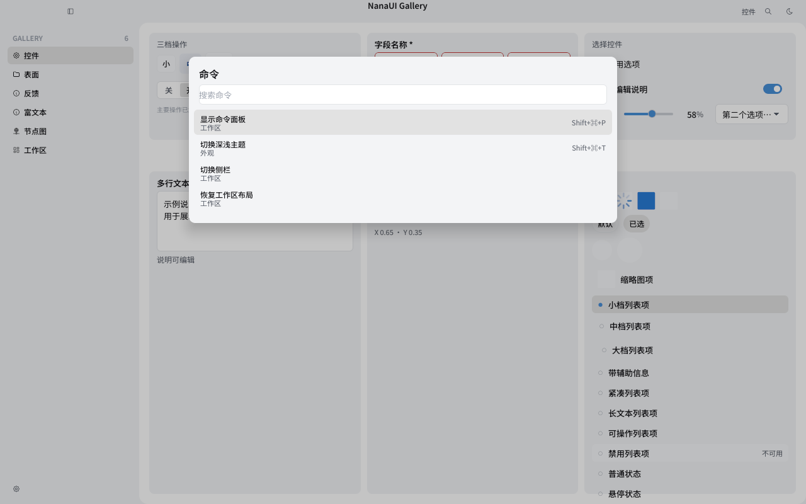
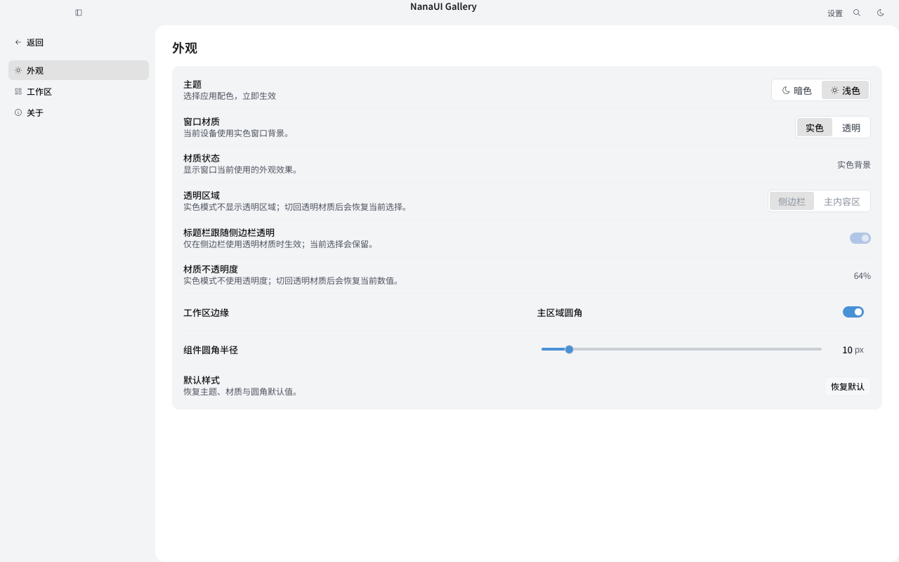
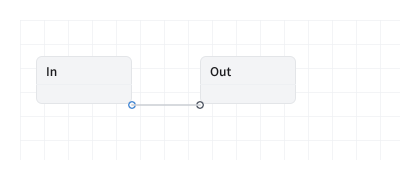

<p align="center">
  
</p>

<p align="center">
  <b>English</b> · <a href="README.zh-CN.md">简体中文</a>
</p>

<p align="center">
  A retained-mode Rust UI framework where live GPU content is an ordinary node in the UI tree.
</p>

<p align="center">
  
  
</p>

<p align="center">
  <a href="https://sena-nana.github.io/NanaUI/">Documentation</a> ·
  <a href="https://sena-nana.github.io/NanaUI/guide/quick-start">Quick start</a> ·
  <a href="https://sena-nana.github.io/NanaUI/guide/introduction">Guide</a> ·
  <a href="https://sena-nana.github.io/NanaUI/components/">Components</a> ·
  <a href="https://sena-nana.github.io/NanaUI/architecture/">Architecture</a> ·
  <a href="https://sena-nana.github.io/NanaUI/learn/">Architecture Deep Dive</a> ·
  <a href="examples">Examples</a>
</p>

<p align="center">
  <picture>
    <source media="(prefers-color-scheme: dark)" srcset="examples/component-gallery/snapshots/metal-apple-m4/gallery-workspace-dark.png">
    
  </picture>
</p>

> [!WARNING]
> NanaUI is in early development (`0.1.0-alpha.1` pre-release preparation for crates.io), and the API will keep changing.

## Why NanaUI

NanaUI started from one concrete need: mixing live GPU content and a complete desktop UI in the same window. Most toolkits force a choice. Either the UI owns the window and GPU content is squeezed into a texture or a hole cut into the interface; or a renderer owns the window and UI becomes a HUD painted on top, leaving clipping, hit testing, focus, accessibility and native window behavior for you to rebuild.

In NanaUI, live GPU content is an ordinary node in the retained UI tree. It participates in layout, rounded-corner and scroll clipping, hit testing and document order alongside buttons and text. Your application owns the Window, Surface and WGPU device, and NanaUI paints the tree into the frames you give it.

That makes it a natural fit for editors and creative tools with preview viewports, games that need menus and HUDs, and real-time tools such as shader debuggers and visualizers. Because NanaUI treats layout, text shaping, IME, accessibility, theming, hot reload, diagnostics and packaging as one system, you do not have to assemble those pieces yourself.

## Design goals

- **One retained tree.** Controls, text and live GPU nodes share `UiWorld`, one pure `Flex + Grid (+ subgrid) + Inline + Layers + Overlay` layout engine, one hit-test index and one text engine.
- **Host-owned GPU & precompiled shaders.** The window, surface and single WGPU device (`third_party/wgpu` fork with rasterizer-ordered storage textures) belong to the application. Built-in shaders ship precompiled (compressed MSL on Apple, compacted Naga IR elsewhere), with no second `Device` and no CPU readback on product paths.
- **Work proportional to change & bounded stack.** Clean frames do no work, local edits recompute only what they affect (verified in CI via zero-overhead `WorkCounters`), and heap-iterative measurement and mounting eliminate `stacker` / `psm` completely (`52 KiB` thread stack at 500 levels of nesting).
- **Modular completeness (`default = []`).** Every crate defaults to minimal features so applications opt in only to what they use — from windowing, IME and AccessKit to headless testing, `.nlog` diagnostics, signed resource packs and `[profile.dist]` builds.

NanaUI is not a browser shell, does not offer an immediate-mode API, and is not a game engine. Scenes, physics and asset pipelines stay with your renderer; NanaUI handles the UI and composites your live content inside it.

## Architecture at a glance

<p align="center">
  
</p>

- **Single product path:** `nana-ui-core` (shared contracts) → `nana-ui-runtime` (`UiWorld`, layout, input, controls) → `nana-ui-scene` (backend-neutral `UiScene` & `FramePlan`) → `nana-ui` (`SceneWgpuPainter` & host adapter).
- **Build-time CSS only:** `nana-ui-css` runs at build time inside `view!`, `css!`, `stylesheet!` and `.vue` compilation to emit static Style Model patches; runtime crates contain zero CSS parsing.
- **Strict host ownership:** Your application holds `Window`, `Surface`, `GpuContext` and `FrameContext`; ordinary controls never see raw window handles (`nana-window` isolates materials, chrome and screen sampling).

See [Architecture](https://sena-nana.github.io/NanaUI/architecture/) for the application author mental model, or [Architecture Deep Dive](https://sena-nana.github.io/NanaUI/learn/) for a full 25-crate source walkthrough.

## Features

| Area | What you get |
| --- | --- |
| Controls | 89 documented built-in controls: forms, lists, tables, trees, dialogs, drawers, toasts, date & color pickers (with native screen eyedropper), node graphs (`GraphCanvas`), DCC timeline (`TimelineEditor`), `PropertyGrid`, rich text editor |
| Layout & Styling | Pure `Flex + Grid (+ subgrid) + Inline + Layers + Overlay`; build-time CSS subset calibrated on 147 Chrome 152 fixtures; CSS Color 4 (`oklch`, `color-mix`), wide-gamut & automatic HDR `Rgba16Float` presentation, light/dark & custom material shaders |
| Desktop shell & windows | `AppShell`, `DesktopShell`, `Workspace`, `Dock`, `AreaLayout`, `CommandPalette`, auxiliary parented windows, `Underlay`; Mica / Acrylic / Vibrancy with explicit outcome or fallback |
| Text & rich content | In-house `nana-text`: shaping, layout, vertical text, BiDi, IME preedit, CLDR locale formatting, `mmap` system fonts; native Markdown, KaTeX math, native `nana-ui-diagram` (all 34 Mermaid families) and GPU ECharts-style charts without a browser |
| Authoring | Plain Rust builders (`nana_ui::runtime`), `view!` / `css!` / `stylesheet!` macros, and `.vue` single-file components with Rust scripts |
| GPU & interop | Host-owned WGPU fork (ROV / pixel interlock / `raster_order_group`), precompiled MSL / Naga IR, `HostTexture`, `GpuView`, lock-free `FrameExchange`, windowless `ExternalSurface` |
| Tooling & packaging | Incremental AccessKit tree, debug-only hot reload, headless snapshots & agent sessions, `.nlog` structured diagnostics, signed/encrypted `.nrpack` packs, Steam output & `[profile.dist]` |

## Example

The same counter written three ways. Plain Rust functions and `view!` are first-class styles over `nana_ui::runtime`; `.vue` single-file components compile at build time into the exact same function calls and `UiWorld` tree.

<table>
<tr>
<th align="left" valign="top" width="120">Rust</th>
<td>

```rust
fn counter() -> impl IntoView {
    let count = signal(0u64);
    row().gap(8).children((
        text!("Count: {count}"),
        button("Increment").on_activate(move || count.update(|c| *c += 1)),
    ))
}
```

</td>
</tr>
<tr>
<th align="left" valign="top" width="120">Rust · <code>view!</code></th>
<td>

```rust
fn counter() -> impl IntoView {
    let count = signal(0u64);
    view! {
        <Row gap=8>
            <Text>"Count: {count}"</Text>
            <Button @activate={count.update(|c| *c += 1)}>"Increment"</Button>
        </Row>
    }
}
```

</td>
</tr>
<tr>
<th align="left" valign="top" width="120"><code>.vue</code></th>
<td>

```vue
<script setup lang="rust">
let count = signal(0);
</script>

<template>
  <Row :gap="8">
    <Text>Count: {{ count }}</Text>
    <Button @activate="count.update(|c| *c += 1)">Increment</Button>
  </Row>
</template>
```

</td>
</tr>
</table>

For complete runnable programs, see [`application-counter`](crates/nana-ui/examples/application-counter.rs), [`reactive-counter`](crates/nana-ui/examples/reactive-counter.rs) and [`examples/reactive-sfc`](examples/reactive-sfc).

## Mixing live GPU & other renderers

Because GPU content is an ordinary node in the tree, whatever another renderer draws can become a `HostTexture` or `GpuView` node in NanaUI — laid out, clipped and ordered with surrounding NanaUI controls on the same WGPU device and frame submission.

For a live custom WGPU shader viewport mixed into the same UI tree, run:

```bash
cargo run -p nana-ui --example hosted-gpu-demo --features hosted,bundled-fonts,wgpu-interop,runtime-wgsl
```

## Screenshots

<table>
  <tr>
    <td width="50%" align="center">
      <picture>
        <source media="(prefers-color-scheme: dark)" srcset="examples/component-gallery/snapshots/metal-apple-m4/gallery-controls-dark.png">
        
      </picture>
      <sub>Controls: size tiers, form validation, selection and sliders</sub>
    </td>
    <td width="50%" align="center">
      <picture>
        <source media="(prefers-color-scheme: dark)" srcset="examples/component-gallery/snapshots/metal-apple-m4/gallery-rich-text-dark.png">
        
      </picture>
      <sub>Rich text: vertical writing, Markdown, KaTeX and native Mermaid</sub>
    </td>
  </tr>
  <tr>
    <td width="50%" align="center">
      <picture>
        <source media="(prefers-color-scheme: dark)" srcset="examples/component-gallery/snapshots/metal-apple-m4/gallery-data-dark.png">
        
      </picture>
      <sub>Data visualization: bar/line combination, donut and calendar heatmap</sub>
    </td>
    <td width="50%" align="center">
      <picture>
        <source media="(prefers-color-scheme: dark)" srcset="examples/component-gallery/snapshots/metal-apple-m4/gallery-surfaces-split-dark.png">
        
      </picture>
      <sub>Lists, trees, surface tiers and split panes</sub>
    </td>
  </tr>
  <tr>
    <td width="50%" align="center">
      <picture>
        <source media="(prefers-color-scheme: dark)" srcset="examples/component-gallery/snapshots/metal-apple-m4/gallery-command-palette-dark.png">
        
      </picture>
      <sub>Command palette and modal overlay layer</sub>
    </td>
    <td width="50%" align="center">
      <picture>
        <source media="(prefers-color-scheme: dark)" srcset="examples/component-gallery/snapshots/metal-apple-m4/gallery-settings-appearance-dark.png">
        
      </picture>
      <sub>Settings page, system materials and appearance switching</sub>
    </td>
  </tr>
</table>

<details>
<summary><b>Creative &amp; DCC controls</b> (TimelineEditor, AreaLayout, GraphCanvas)</summary>
<br>
<table>
  <tr>
    <td width="33%" align="center">
      <picture>
        <source media="(prefers-color-scheme: dark)" srcset="examples/component-gallery/snapshots/metal-apple-m4/component-migration/timeline-editor/dark/curves.png">
        
      </picture>
      <sub><code>TimelineEditor</code> (keyframes &amp; Bézier curves)</sub>
    </td>
    <td width="33%" align="center">
      <picture>
        <source media="(prefers-color-scheme: dark)" srcset="examples/component-gallery/snapshots/metal-apple-m4/component-migration/area-layout/dark/split-preview.png">
        
      </picture>
      <sub><code>AreaLayout</code> (corner drag split &amp; join)</sub>
    </td>
    <td width="33%" align="center">
      <picture>
        <source media="(prefers-color-scheme: dark)" srcset="examples/component-gallery/snapshots/metal-apple-m4/component-migration/graph-canvas/dark/nodes.png">
        
      </picture>
      <sub><code>GraphCanvas</code> (node graph &amp; ports)</sub>
    </td>
  </tr>
</table>
</details>

<p align="center"><sub>Screenshots are rendered output from the <a href="examples/component-gallery">component-gallery</a> snapshot tests (Metal, Apple M4). They adapt automatically to your GitHub theme. The gallery UI text is in Chinese.</sub></p>

## Built with NanaUI

<table>
  <tr>
    <td width="50%" valign="top">
      
      <b>NanaType</b><br>
      <sub>A live-streaming typewriter for VTubers: lines you type play out character by character in an AVG / RPG dialogue box and go to OBS via Spout2 / Syphon.</sub><br>
      <a href="https://github.com/sena-nana/NanaType">GitHub</a> ·
      <a href="https://store.steampowered.com/app/5507600">Steam</a>
    </td>
    <td width="50%" valign="top">
      
      <b>NanaLive</b><br>
      <sub>Live2D desktop scenes and stream output for VTubers.</sub><br>
      <sub>In development</sub>
    </td>
  </tr>
</table>

## Getting started

NanaUI requires Rust 1.98 or newer. From the repository root, try the examples first:

```bash
cargo run -p component-gallery
```

```bash
cargo run -p nana-ui --example gpu-view-demo --features hosted,bundled-fonts
```

The first opens the full control and workspace gallery; the second embeds a live GPU node in the same window (`hosted-gpu-demo` adds `wgpu-interop,runtime-wgsl`; `viewport-3d-demo` adds `wgpu-interop,runtime-wgsl,view-macro` for an offscreen 3D `HostTexture` viewport). To add NanaUI to your own project:

```toml
[dependencies]
nana-ui = { git = "https://github.com/sena-nana/NanaUI", features = ["hosted", "bundled-fonts", "view-macro"] }
```

For compact release packaging, build with the workspace distribution profile (`opt-level = "z"`, fat LTO, `panic = "abort"`, symbol stripping):

```bash
cargo build --profile dist
```

<details>
<summary><b>Cargo features (<code>default = []</code>, opt-in)</b></summary>
<br>

`nana-ui`, `nana-ui-runtime` and `nana-ui-scene` all set `default = []`. Enabling `gpu` or `hosted` compiles only the platform's primary graphics backend (`metal` on Apple, `dx12` on Windows, `vulkan` on Unix).

| Feature | Purpose |
| --- | --- |
| `hosted` | Desktop host: windows, event loop, AccessKit platform adapter; implies `gpu` |
| `gpu` | `SceneWgpuPainter`, `HostTexture`, `FrameExchange`, windowless output (primary backend only, precompiled shader archives) |
| `bundled-fonts` | Embeds Noto Sans SC as the default UI font (~4.2 MiB); without it, text uses system fonts |
| `view-macro` | The `view!`, `css!` and `stylesheet!` compile-time macros |
| `components` | Enables `area-layout`, `calendar`, `charts`, `controls`, `diff-view`, `dock`, `graph-canvas`, `image-viewer`, `paint-script`, `property-grid`, `qr-code`, `rich-text`, `terminal` and `timeline` |
| `wgpu-backends` | Enables all standard cross-platform WGPU backends (`dx12`, `vulkan`, `gles`, `metal`) when `gpu` is active |
| `runtime-wgsl` | Runtime WGSL shader compilation (`naga` / `wgpu` WGSL) for custom user `MaterialProgram` shaders |
| `wgpu-interop` | Escape hatch exposing underlying WGPU objects on `GpuContext` and `FrameContext` |
| `icu` | ICU4X CLDR locale formatting for numbers, dates and plurals (`PlainFormatter` when off) |
| `snippet-transforms` | Regular-expression transforms in snippets (`fancy-regex`) |
| `http-fetch` | Built-in `ureq` `http(s)://` image/resource fetching (off by default unless enabled or custom `FetchHost`) |
| `image-codecs-extra` | Extra JPEG, GIF and WebP decoding in `image` (PNG stays available) |
| `svg` | CPU-side SVG image rasterization (`usvg` / `resvg`; built-in icons render from vector geometry without it) |
| `packaged-resources` | `.nrpack` resource pack mounting and `NANA_PACKAGE_VALIDATE` self-check |
| `full` | Convenience desktop bundle: `bundled-fonts`, `components`, `hosted`, `http-fetch`, `icu`, `image-codecs-extra`, `runtime-wgsl`, `snippet-transforms`, `svg`, `syntax-highlighting`, `wgpu-backends` |

The complete list is in [`nana-ui`](crates/nana-ui) and [Layout & Feature Migration](https://sena-nana.github.io/NanaUI/guide/migration-layout-and-features).

</details>

Next, read [Quick start](https://sena-nana.github.io/NanaUI/guide/quick-start) and [Creating an application](https://sena-nana.github.io/NanaUI/guide/essentials/application).

## Platform support

| Platform | Primary GPU / Window | Status |
| --- | --- | --- |
| Windows 10 / 11 | DX12 · Mica / Acrylic | Supported |
| macOS 14+ | Metal (precompiled MSL 3.1) · Vibrancy | Supported |
| Linux | Vulkan (X11 / Wayland) · system materials unavailable | Supported |
| Android / iOS 17+ | Vulkan / Metal | Experimental |
| OpenHarmony | Vulkan | Builds only |

## Performance & footprint

| Measurement | Result |
| --- | --- |
| Dispatching a pointer move over a list of 250 to 2 000 rows | `0.3 µs`, independent of row count |
| Changing one control's text on 42 001 boxes / 100k tree p95 local scaling | `21 µs` full frame · `1.17×` (`30.2 µs` at 100k vs `25.8 µs` at 1k) |
| Minimum thread stack for 500 levels of nesting (zero `stacker` / `psm`) | `52 KiB` full frame (Taffy 0.11: `900 KiB`) |
| Live heap per box (`stack-depth wide`, 21 001 boxes) / laid-out `Stack` | `943 B / box` (Taffy 0.11: `1 506 B / box`) · `634 B` per 10k `Stack` |
| Cold full-page flex layout, 21 001 boxes, per box (Taffy 0.11: `0.71 µs`) | `0.91–1.00 µs` (retaining incremental plans & `LayoutResult`) |
| Distribution binary size (`[profile.dist]`, `reactive-sfc` + precompiled MSL) | `5.56 MiB` (down from `15.80 MiB`, `-64.8%`; `0 B` resident naga IR on Apple) |

Measured on an Apple M4 with `release` / `dist` builds. Cold layout matches [Taffy](https://github.com/DioxusLabs/taffy) 0.11 box-for-box (`0.0000 px` worst delta) while retaining incremental measurement plans, dependency footprints and `LayoutResult` snapshots for zero-measure edits and accessibility. Methodology and reproduction commands are in [Resource budgets](https://sena-nana.github.io/NanaUI/reference/resource-budgets), [Taffy reference benchmark](https://sena-nana.github.io/NanaUI/reference/taffy-reference) and [`perf/`](perf/README.md).

## Project layout

Applications usually depend on `nana-ui` only. All 25 crates under `crates/` (24 workspace members + standalone `nana-icons-tabler`, 58 acyclic normal dependency edges) plus the vendored `third_party/wgpu` fork are documented in [Architecture contracts](https://sena-nana.github.io/NanaUI/reference/architecture) and [Modules and layers](https://sena-nana.github.io/NanaUI/learn/modules-and-layers).

<details>
<summary><b>All 25 crates by architectural layer</b></summary>
<br>

| Layer | Crate | Description |
| --- | --- | --- |
| Core pipeline | [`nana-ui`](crates/nana-ui) | Facade crate: application entry points, desktop host, WGPU painting |
| Core pipeline | [`nana-ui-scene`](crates/nana-ui-scene) | Backend-neutral drawable scene (`UiScene`, `FramePlan`, `RenderGraph`) |
| Core pipeline | [`nana-ui-runtime`](crates/nana-ui-runtime) | Retained UI tree (`UiWorld`), components, iterative layout, input, accessibility |
| Core pipeline | [`nana-ui-core`](crates/nana-ui-core) | Shared contracts: Style Model, OKLCH/Color 4, themes, geometry, Motion IR |
| Engines & platform | [`nana-text`](crates/nana-text) | In-house text shaping, layout & glyph rasterization engine |
| Engines & platform | [`nana-ui-css`](crates/nana-ui-css) | Build-time CSS parser, selector matching & cascade engine |
| Engines & platform | [`nana-ui-input`](crates/nana-ui-input) | Canonical input events, sequencer & `HostServices` contract |
| Engines & platform | [`nana-gpu`](crates/nana-gpu) | Backend-neutral GPU contract (`GpuContext`, `FrameContext`, `GpuTexture`) |
| Engines & platform | [`nana-frame-exchange`](crates/nana-frame-exchange) | Bounded lock-free GPU frame exchange across threads |
| Engines & platform | [`nana-window`](crates/nana-window) | Native windows, system materials, client chrome, `ColorSampler` & `WebSurface` |
| Engines & platform | [`nana-ui-platform`](crates/nana-ui-platform) | Platform-neutral window, clipboard, fetch & path contracts |
| Engines & platform | [`nana-diagnostics`](crates/nana-diagnostics) | Zero-I/O structured diagnostics & `.nlog` flight recorder |
| Authoring toolchain | [`nana-ui-sfc`](crates/nana-ui-sfc) | `.vue` single-file component compiler (Rust scripts) |
| Authoring toolchain | [`nana-ui-view-macros`](crates/nana-ui-view-macros) | `view!`, `css!` and `stylesheet!` proc macros |
| Authoring toolchain | [`nana-ui-view-codegen`](crates/nana-ui-view-codegen) | Shared template code generator (internal) |
| Authoring toolchain | [`nana-ui-view-schema`](crates/nana-ui-view-schema) | Single built-in control schema table (internal) |
| Rich content & assets | [`nana-ui-charts`](crates/nana-ui-charts) | ECharts-shaped chart model & GPU mark arrays |
| Rich content & assets | [`nana-ui-diagram`](crates/nana-ui-diagram) | Native Mermaid diagram engine (all 34 diagram families) |
| Rich content & assets | [`nana-ui-viewport3d`](crates/nana-ui-viewport3d) | Optional lightweight 3D preview viewport (orbit camera, glTF, lighting, `HostTexture` output) |
| Rich content & assets | [`nana-svg-raster`](crates/nana-svg-raster) | CPU-side SVG image rasterization (`resvg`) |
| Rich content & assets | [`nana-icons-tabler`](crates/nana-icons-tabler) | Generated Tabler vector icon catalog (standalone, linker-GC'd) |
| Rich content & assets | [`nana-app-icon`](crates/nana-app-icon) | Default mark, PNG/ICO/ICNS encoding & Windows PE icon embedding |
| Rich content & assets | [`nana-package`](crates/nana-package) | Pure-Rust `.nrpack` resource pack runtime reader |
| Rich content & assets | [`nana-packager`](crates/nana-packager) | Build-side packager & tamper-validation CLI |
| Dev & testing | [`nana-ui-dev`](crates/nana-ui-dev) | Debug-only hot reload watcher |
| Dev & testing | [`nana-ui-devtools`](crates/nana-ui-devtools) | Headless snapshots & automated debugging agent sessions |

</details>

## Contributing

Before you start, read [AGENTS.md](AGENTS.md), which describes the framework's boundaries and non-negotiable contracts. Before submitting, run:

```bash
cargo fmt --all -- --check
python3 scripts/check-engine-boundary.py
python3 scripts/check-test-hygiene.py
cargo test --workspace -- --test-threads=1
```

## License

NanaUI is dual-licensed under [MIT](LICENSE-MIT) or [Apache-2.0](LICENSE-APACHE), at your option.

Unless you explicitly state otherwise, any contribution intentionally submitted for inclusion in NanaUI by you, as defined in the Apache-2.0 license, shall be dual-licensed as above, without any additional terms or conditions.
