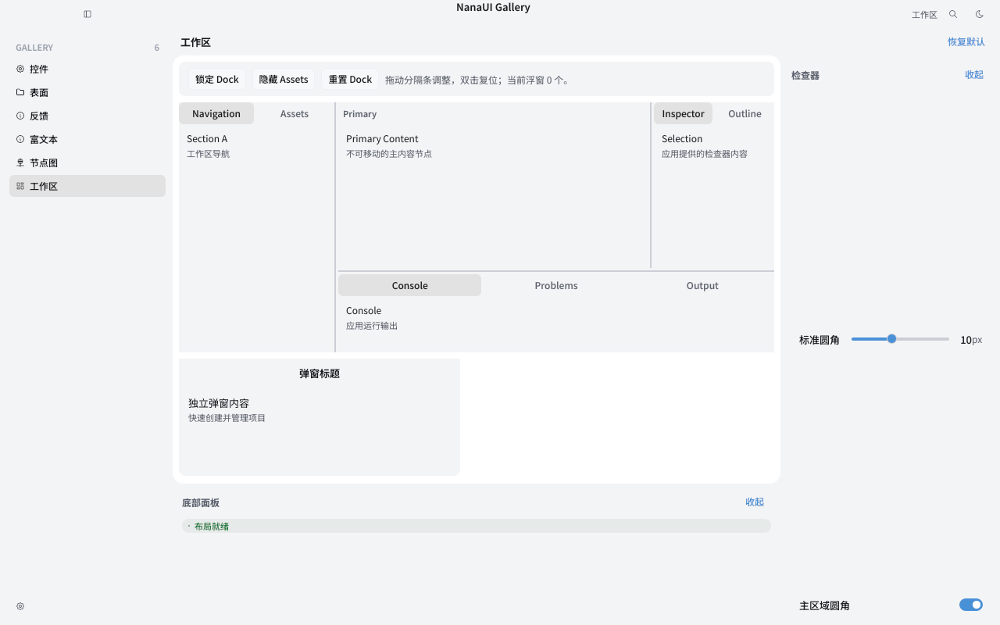
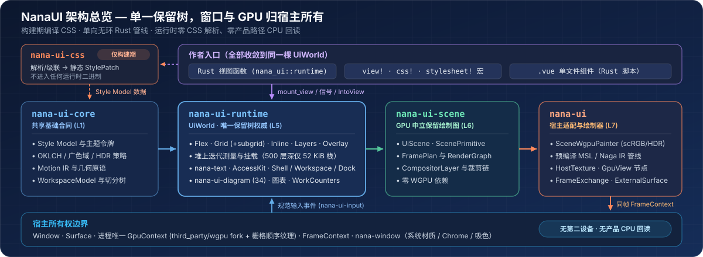
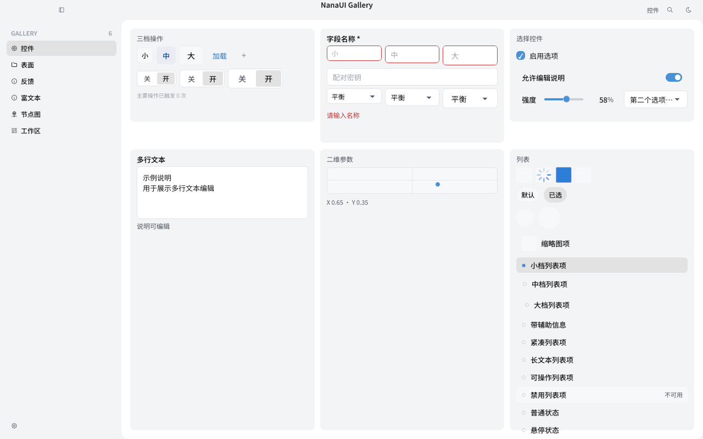
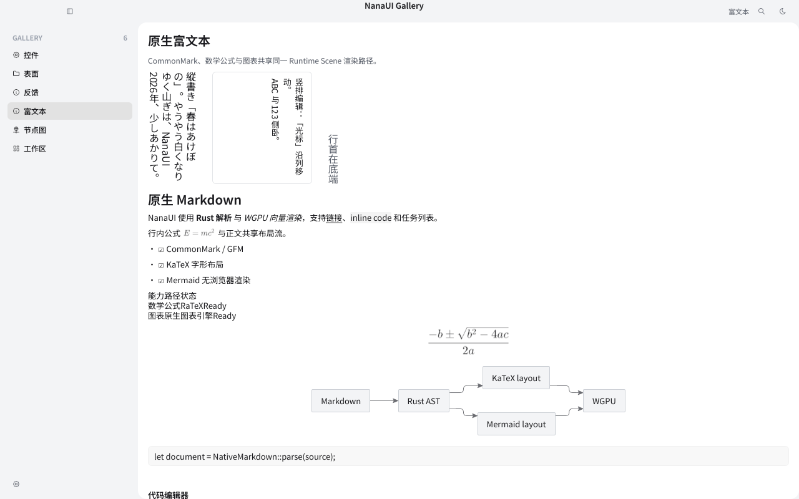
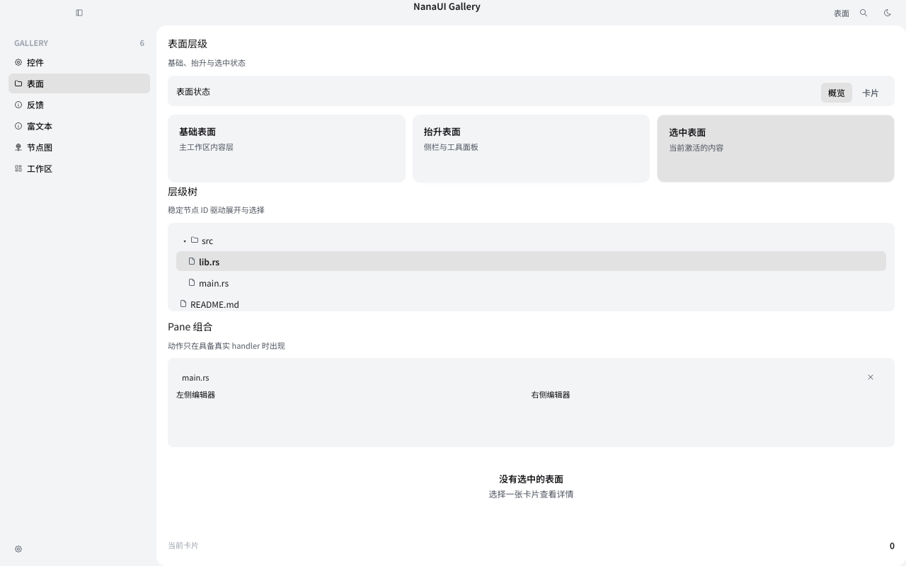
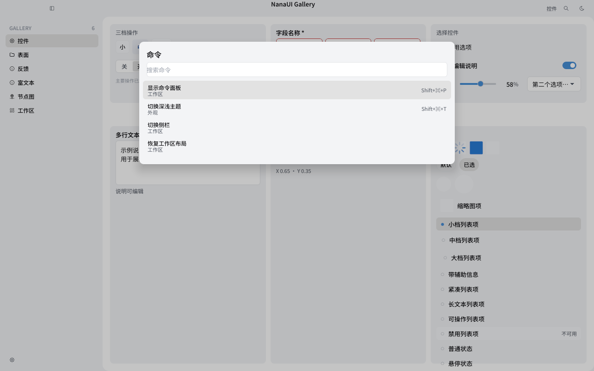
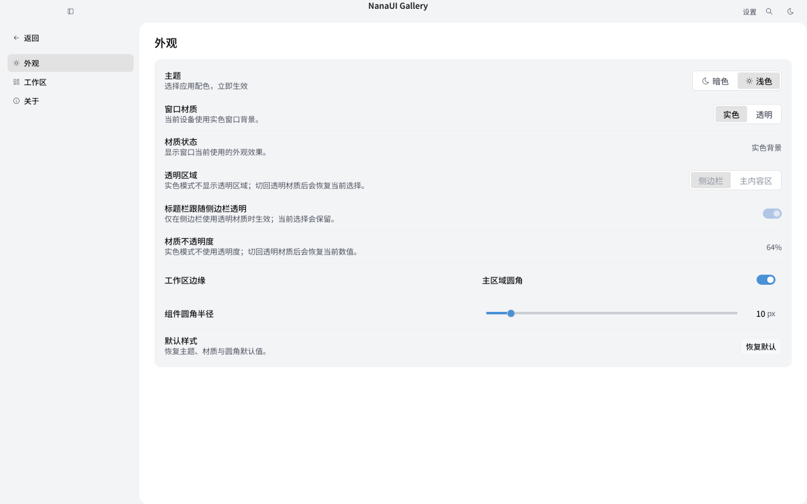
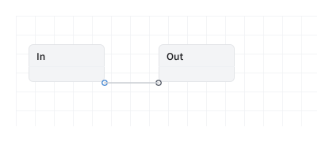

<p align="center">
  
</p>

<p align="center">
  <a href="README.md">English</a> · <b>简体中文</b>
</p>

<p align="center">
  一个把实时 GPU 画面作为普通界面节点的保留式 Rust UI 框架。
</p>

<p align="center">
  
  
</p>

<p align="center">
  <a href="https://sena-nana.github.io/NanaUI/zh/">文档</a> ·
  <a href="https://sena-nana.github.io/NanaUI/zh/guide/quick-start">快速开始</a> ·
  <a href="https://sena-nana.github.io/NanaUI/zh/guide/introduction">指南</a> ·
  <a href="https://sena-nana.github.io/NanaUI/zh/components/">组件</a> ·
  <a href="https://sena-nana.github.io/NanaUI/zh/architecture/">架构</a> ·
  <a href="https://sena-nana.github.io/NanaUI/zh/learn/">架构学习</a> ·
  <a href="examples">示例</a>
</p>

<p align="center">
  <picture>
    <source media="(prefers-color-scheme: dark)" srcset="examples/component-gallery/snapshots/metal-apple-m4/gallery-workspace-dark.png">
    
  </picture>
</p>

> [!WARNING]
> NanaUI 仍在早期开发中，还没有发布到 crates.io，API 会持续变化。

## 为什么做 NanaUI

NanaUI 最初是为了一个具体的需求：在同一个窗口里把实时的 GPU 画面和完整的桌面界面混合在一起。我们试过的方案大多只能二选一：要么界面是主角，GPU 画面只能当贴图、或者在界面上挖一个洞；要么渲染是主角，界面是叠在画面上的一层 HUD，裁剪、点击、焦点、无障碍和窗口行为都得自己补。

在 NanaUI 里，GPU 画面是保留式界面树上的一个普通节点，和按钮、文字一起参与排版、圆角与滚动裁剪、命中测试和绘制顺序。应用自己持有 Window、Surface 和 WGPU 设备，NanaUI 只画进应用交给它的帧。

因此它适用于带预览视口的编辑器与创作工具、需要菜单与 HUD 的游戏，以及着色器调试与可视化这类实时工具。同时，NanaUI 把布局、文本塑形、输入法、无障碍、主题、热重载、诊断和打包作为一个完整系统来设计，不需要应用自己拼装。

## 设计目标

- **单一保留树。** 控件、文字和 GPU 内容都在同一棵 `UiWorld` 里，共用纯 `Flex + Grid (+ subgrid) + Inline + Layers + Overlay` 布局引擎、同一套命中索引和同一个文字引擎。
- **GPU 归应用所有与预编译着色器。** 窗口、Surface 和进程唯一的 WGPU 设备（带栅格顺序存储纹理的 `third_party/wgpu` fork）属于应用；内置着色器离线预编译（Apple 平台为压缩 MSL，其余平台为紧致 Naga IR），不创建第二个 Device，产品路径不做 CPU 回读。
- **工作量与改动成正比、栈占用有界。** 无变更的帧不做工作，局部修改只重算受影响范围（CI 由零开销 `WorkCounters` 守卫）；测量与挂载全面改为堆上显式迭代，彻底移除 `stacker` / `psm`（500 层深树整帧仅需 `52 KiB` 栈）。
- **模块化完整度（`default = []`）。** 核心 crate 默认关闭所有可选特性，按需启用桌面宿主、IME、AccessKit、无头测试、`.nlog` 诊断、加密签名资源包与 `[profile.dist]` 极简发布配置。

NanaUI 不是浏览器套壳，不提供即时模式 API，本身也不是游戏引擎：场景、物理和资源管线仍由你的引擎或渲染代码负责，NanaUI 负责界面，并把你的画面放进界面里。

## 架构一览

<p align="center">
  
</p>

- **单一产品路径：** `nana-ui-core`（共享合同）→ `nana-ui-runtime`（`UiWorld`、布局、输入、控件）→ `nana-ui-scene`（与图形后端无关的 `UiScene` 与 `FramePlan`）→ `nana-ui`（`SceneWgpuPainter` 与宿主适配器）。
- **仅构建期 CSS：** `nana-ui-css` 只在 `view!`、`css!`、`stylesheet!` 与 `.vue` 构建期运行并编译为 Style Model 补丁；运行时 crate 零 CSS 解析。
- **宿主所有权边界：** 应用持有 `Window`、`Surface`、`GpuContext` 与 `FrameContext`；普通控件永远拿不到原生句柄（`nana-window` 隔离材质、客户区 chrome 与屏幕吸色）。

应用作者心智模型见 [架构总览](https://sena-nana.github.io/NanaUI/zh/architecture/)，25 个 crate 的源码级拆解见 [架构学习](https://sena-nana.github.io/NanaUI/zh/learn/)。

## 功能

| 领域 | 内容 |
| --- | --- |
| 控件 | 89 个文档化内置控件：表单、列表、表格、树、对话框、抽屉、Toast、日期与颜色选择器（支持原生屏幕吸色）、节点图（`GraphCanvas`）、时间线（`TimelineEditor`）、`PropertyGrid`、富文本编辑器 |
| 布局与样式 | 纯 `Flex + Grid (+ subgrid) + Inline + Layers + Overlay`；经 147 组 Chrome 152 夹具校准的构建期 CSS 子集；CSS Color 4（`oklch`、`color-mix`）、广色域与按需自动 `Rgba16Float` HDR 呈现、明暗与自定义材质着色器 |
| 桌面壳层与窗口 | `AppShell`、`DesktopShell`、`Workspace`、`Dock`、`AreaLayout`、`CommandPalette`、伴生子窗口与 `Underlay`；Mica / Acrylic / Vibrancy 系统材质及显式回退 |
| 文字与富内容 | 自研 `nana-text`（`mmap` 系统字体、塑形、排版、竖排、双向文本、IME 组合输入、CLDR 格式化）；原生 Markdown、KaTeX 公式、支持全部 34 种 Mermaid 图表的原生 `nana-ui-diagram` 与 ECharts 风格 GPU 图表，全程不经浏览器 |
| 写法 | Rust 视图函数（`nana_ui::runtime`）、`view!` / `css!` / `stylesheet!` 宏、脚本用 Rust 写的 `.vue` 单文件组件 |
| GPU 与互操作 | 宿主持有 WGPU fork（DX12 ROV / Vulkan 像素互锁 / Metal `raster_order_group`）、预编译 MSL / Naga IR、`HostTexture`、`GpuView`、无锁 `FrameExchange`、无窗口 `ExternalSurface` |
| 工具与打包 | 基于 AccessKit 的增量无障碍树、仅限 debug 的热重载、无头快照与调试会话、`.nlog` 诊断日志、加密签名 `.nrpack` 资源包、Steam 输出与 `[profile.dist]` |

## 示例

同一个计数器的三种写法。Rust 函数调用和 `view!` 宏都是 `nana_ui::runtime` 的一级写法；`.vue` 单文件组件在构建期编译成相同的函数调用和同一棵 `UiWorld` 界面树。

<table>
<tr>
<th align="left" valign="top" width="120">Rust 函数</th>
<td>

```rust
fn counter() -> impl IntoView {
    let count = signal(0u64);
    row().gap(8).children((
        text!("计数 {count}"),
        button("增加").on_activate(move || count.update(|c| *c += 1)),
    ))
}
```

</td>
</tr>
<tr>
<th align="left" valign="top" width="120">Rust · <code>view!</code></th>
<td>

```rust
fn counter() -> impl IntoView {
    let count = signal(0u64);
    view! {
        <Row gap=8>
            <Text>"计数 {count}"</Text>
            <Button @activate={count.update(|c| *c += 1)}>"增加"</Button>
        </Row>
    }
}
```

</td>
</tr>
<tr>
<th align="left" valign="top" width="120"><code>.vue</code></th>
<td>

```vue
<script setup lang="rust">
let count = signal(0);
</script>

<template>
  <Row :gap="8">
    <Text>计数 {{ count }}</Text>
    <Button @activate="count.update(|c| *c += 1)">增加</Button>
  </Row>
</template>
```

</td>
</tr>
</table>

完整可运行的程序见 [`application-counter`](crates/nana-ui/examples/application-counter.rs)、[`reactive-counter`](crates/nana-ui/examples/reactive-counter.rs) 和 [`examples/reactive-sfc`](examples/reactive-sfc)。

## 混合实时 GPU 画面与其他 UI 框架

因为 GPU 内容是树上的普通节点，其他渲染器或 UI 框架画出来的内容也可以作为 `HostTexture` 或 `GpuView` 节点放进 NanaUI——和周围的 NanaUI 控件一起排版、裁剪与排序，共用同一个 WGPU 设备和同一次提交。

<p align="center">
  
</p>

[`egui-in-nanaui`](crates/nana-ui/examples/egui-in-nanaui.rs) 把右侧的 egui 面板挂成 `GpuView` 节点，与左侧 NanaUI 控件并排放在同一个窗口里，读写同一份状态并共用同一次 WGPU 渲染通道：

```bash
cargo run -p nana-ui --example egui-in-nanaui --features hosted,bundled-fonts,wgpu-interop
```

如需运行自定义 WGPU 着色器视口或离屏 3D 视口与界面控件同窗混排示例：

```bash
cargo run -p nana-ui --example hosted-gpu-demo --features hosted,bundled-fonts,wgpu-interop,runtime-wgsl
cargo run -p nana-ui --example viewport-3d-demo --features hosted,bundled-fonts,wgpu-interop,runtime-wgsl,view-macro
```

## 截图

<table>
  <tr>
    <td width="50%" align="center">
      <picture>
        <source media="(prefers-color-scheme: dark)" srcset="examples/component-gallery/snapshots/metal-apple-m4/gallery-controls-dark.png">
        
      </picture>
      <sub>控件：尺寸档位、表单校验、选择与滑块</sub>
    </td>
    <td width="50%" align="center">
      <picture>
        <source media="(prefers-color-scheme: dark)" srcset="examples/component-gallery/snapshots/metal-apple-m4/gallery-rich-text-dark.png">
        
      </picture>
      <sub>富文本：竖排、Markdown、KaTeX 与原生 Mermaid</sub>
    </td>
  </tr>
  <tr>
    <td width="50%" align="center">
      <picture>
        <source media="(prefers-color-scheme: dark)" srcset="examples/component-gallery/snapshots/metal-apple-m4/gallery-data-dark.png">
        
      </picture>
      <sub>数据可视化：柱线组合图、环形图与日历热力图</sub>
    </td>
    <td width="50%" align="center">
      <picture>
        <source media="(prefers-color-scheme: dark)" srcset="examples/component-gallery/snapshots/metal-apple-m4/gallery-surfaces-split-dark.png">
        
      </picture>
      <sub>列表、层级树、表面层级与分栏</sub>
    </td>
  </tr>
  <tr>
    <td width="50%" align="center">
      <picture>
        <source media="(prefers-color-scheme: dark)" srcset="examples/component-gallery/snapshots/metal-apple-m4/gallery-command-palette-dark.png">
        
      </picture>
      <sub>命令面板与模态浮层</sub>
    </td>
    <td width="50%" align="center">
      <picture>
        <source media="(prefers-color-scheme: dark)" srcset="examples/component-gallery/snapshots/metal-apple-m4/gallery-settings-appearance-dark.png">
        
      </picture>
      <sub>设置页、系统材质与外观切换</sub>
    </td>
  </tr>
</table>

<details>
<summary><b>创作与 DCC 类控件</b>（TimelineEditor、AreaLayout、GraphCanvas）</summary>
<br>
<table>
  <tr>
    <td width="33%" align="center">
      <picture>
        <source media="(prefers-color-scheme: dark)" srcset="examples/component-gallery/snapshots/metal-apple-m4/component-migration/timeline-editor/dark/curves.png">
        
      </picture>
      <sub><code>TimelineEditor</code>（关键帧与贝塞尔曲线）</sub>
    </td>
    <td width="33%" align="center">
      <picture>
        <source media="(prefers-color-scheme: dark)" srcset="examples/component-gallery/snapshots/metal-apple-m4/component-migration/area-layout/dark/split-preview.png">
        
      </picture>
      <sub><code>AreaLayout</code>（角拖切分与合并）</sub>
    </td>
    <td width="33%" align="center">
      <picture>
        <source media="(prefers-color-scheme: dark)" srcset="examples/component-gallery/snapshots/metal-apple-m4/component-migration/graph-canvas/dark/nodes.png">
        
      </picture>
      <sub><code>GraphCanvas</code>（节点与端口连线）</sub>
    </td>
  </tr>
</table>
</details>

<p align="center"><sub>截图为 <a href="examples/component-gallery">component-gallery</a> 快照测试的渲染输出（Metal，Apple M4），随 GitHub 主题自动切换亮色与暗色版本。</sub></p>

## 使用 NanaUI 的应用

<table>
  <tr>
    <td width="50%" valign="top">
      
      <b>NanaType</b><br>
      <sub>虚拟主播直播打字机：把打下的台词逐字演成 AVG / RPG 对话框，经 Spout2 / Syphon 送进 OBS。</sub><br>
      <a href="https://github.com/sena-nana/NanaType">GitHub</a> ·
      <a href="https://store.steampowered.com/app/5507600">Steam</a>
    </td>
    <td width="50%" valign="top">
      
      <b>NanaLive</b><br>
      <sub>面向虚拟主播的 Live2D 桌面场景与直播输出软件。</sub><br>
      <sub>开发中</sub>
    </td>
  </tr>
</table>

## 开始使用

需要 Rust 1.98 或更新版本。先在仓库根目录运行示例：

```bash
cargo run -p component-gallery
```

```bash
cargo run -p nana-ui --example gpu-view-demo --features hosted,bundled-fonts
```

第一条是完整的控件与工作区画廊，第二条展示树上的实时 GPU 节点（运行自定义 WGSL 着色器演示可使用 `hosted-gpu-demo --features hosted,bundled-fonts,wgpu-interop,runtime-wgsl`）。在自己的项目中加入依赖：

```toml
[dependencies]
nana-ui = { git = "https://github.com/sena-nana/NanaUI", features = ["hosted", "bundled-fonts", "view-macro"] }
```

构建紧凑发行版可执行文件时，请使用工作区提供的分发配置（`opt-level = "z"`、`fat` LTO、`panic = "abort"` 与符号剥离）：

```bash
cargo build --profile dist
```

<details>
<summary><b>Cargo feature（<code>default = []</code>，按需开启）</b></summary>
<br>

`nana-ui`、`nana-ui-runtime` 与 `nana-ui-scene` 均设置 `default = []`。开启 `gpu` 或 `hosted` 时仅编入当前平台主图形后端（Apple 为 `metal`、Windows 为 `dx12`、Unix 为 `vulkan`）。

| Feature | 作用 |
| --- | --- |
| `hosted` | 桌面宿主：窗口、事件循环、平台 AccessKit 适配器，隐含 `gpu` |
| `gpu` | `SceneWgpuPainter`、`HostTexture`、`FrameExchange` 与无窗口输出（仅主后端与预编译着色器归档） |
| `bundled-fonts` | 内置 Noto Sans SC 作为默认 UI 字体（约 4.2 MiB）；不开则回落到系统字体 |
| `view-macro` | 编译期 `view!`、`css!` 与 `stylesheet!` 宏 |
| `components` | 开启 `calendar`、`charts`、`controls`、`diff-view`、`dock`、`graph-canvas`、`image-viewer`、`qr-code`、`rich-text`、`terminal` 与 `vector-boolean` |
| `wgpu-backends` | 在启用 `gpu` 时同时编入全部跨平台标准 WGPU 后端（`dx12`、`vulkan`、`gles`、`metal`） |
| `runtime-wgsl` | 运行时 WGSL 编译（`naga` / `wgpu` WGSL 回退），供自定义用户 `MaterialProgram` 使用 |
| `wgpu-interop` | 逃生口：暴露 `GpuContext` 与 `FrameContext` 背后的原始 WGPU 对象 |
| `icu` | ICU4X CLDR 本地化数字、日期与复数格式（关闭时使用 `PlainFormatter`） |
| `snippet-transforms` | snippet 里的正则变换（`fancy-regex`） |
| `http-fetch` | 基于 `ureq` 的内置 `http(s)://` 资源与图片拉取（默认关闭，也可注入自定义 `FetchHost`） |
| `image-codecs-extra` | 开启 `image` 的 JPEG、GIF、WebP 解码（PNG 始终保留） |
| `svg` | CPU 端 SVG 图片光栅化（`usvg` / `resvg`；内置矢量图标不依赖它） |
| `vector-boolean` | `custom_paint` 中启用 `i_overlay` 路径布尔化简（关闭时改用内置整数平面扫描线布尔求解器） |
| `packaged-resources` | 挂载 `.nrpack` 资源包与响应 `NANA_PACKAGE_VALIDATE` 自检 |
| `full` | 桌面全量集合：`bundled-fonts`、`components`、`hosted`、`http-fetch`、`icu`、`image-codecs-extra`、`runtime-wgsl`、`snippet-transforms`、`svg`、`syntax-highlighting`、`wgpu-backends` |

完整列表见 [`nana-ui`](crates/nana-ui) 与 [布局与特性迁移指南](https://sena-nana.github.io/NanaUI/zh/guide/migration-layout-and-features)。

</details>

接下来阅读 [快速开始](https://sena-nana.github.io/NanaUI/zh/guide/quick-start) 与 [创建应用](https://sena-nana.github.io/NanaUI/zh/guide/essentials/application)。

## 平台支持

| 平台 | 主图形后端 / 窗口能力 | 状态 |
| --- | --- | --- |
| Windows 10 / 11 | DX12 · Mica / Acrylic | 支持 |
| macOS 14+ | Metal（预编译 MSL 3.1）· Vibrancy | 支持 |
| Linux | Vulkan（X11 / Wayland）· 系统材质不可用 | 支持 |
| Android / iOS 17+ | Vulkan / Metal | 实验性 |
| OpenHarmony | Vulkan | 仅保证编译 |

## 性能与体量

| 测量 | 结果 |
| --- | --- |
| 指针移动派发，250 到 2 000 行的列表 | `0.3 µs`，与行数无关 |
| 42 001 盒改一处文本 / 100k 节点局部帧 p95 扩展比 | `21 µs` 整帧 · `1.17×`（100k `30.2 µs` 对 1k `25.8 µs`） |
| 500 层嵌套所需的最低线程栈（无 `stacker` / `psm`） | `52 KiB` 整帧（Taffy 0.11 为 `900 KiB`） |
| 每盒常驻堆（`stack-depth wide`，21 001 盒）/ 已布局 `Stack` | `943 B / 盒`（Taffy 0.11 为 `1 506 B / 盒`）· 10k `Stack` `634 B` |
| 冷启动整页 Flex 布局，21 001 盒，每盒（Taffy 0.11 为 `0.71 µs`） | `0.91–1.00 µs`（保留增量计划与 `LayoutResult`） |
| 分发可执行文件体积（`[profile.dist]`，`reactive-sfc` + 预编译 MSL） | `5.56 MiB`（由 `15.80 MiB` 下降 `64.8%`，Apple 常驻 naga IR `0 B`） |

数据测自 Apple M4 `release` / `dist` 构建。冷布局与 [Taffy](https://github.com/DioxusLabs/taffy) 0.11 逐盒一致（最坏偏差 `0.0000 px`），多出的耗时用于保留增量测量计划、依赖足迹与公开 `LayoutResult` 合同。测量口径与复现命令见 [资源预算](https://sena-nana.github.io/NanaUI/zh/reference/resource-budgets)、[Taffy 对照基准](https://sena-nana.github.io/NanaUI/zh/reference/taffy-reference) 与 [`perf/`](perf/README.md)。

## 项目结构

应用通常只直接依赖 `nana-ui`。`crates/` 下全部 25 个 crate（24 个工作区成员 + 独立的 `nana-icons-tabler`，共 58 条无环普通依赖边）以及内建 `third_party/wgpu` fork 详见 [架构合同](https://sena-nana.github.io/NanaUI/zh/reference/architecture) 与 [模块与分层](https://sena-nana.github.io/NanaUI/zh/learn/modules-and-layers)。

<details>
<summary><b>按架构分层查看全部 25 个 crate</b></summary>
<br>

| 分层 | Crate | 说明 |
| --- | --- | --- |
| 核心管线 | [`nana-ui`](crates/nana-ui) | 门面 crate：应用入口、桌面宿主、WGPU 绘制器 |
| 核心管线 | [`nana-ui-scene`](crates/nana-ui-scene) | 与 GPU 无关的保留绘制图（`UiScene`、`FramePlan`、`RenderGraph`） |
| 核心管线 | [`nana-ui-runtime`](crates/nana-ui-runtime) | 保留树权威（`UiWorld`）、组件、迭代布局、输入、无障碍 |
| 核心管线 | [`nana-ui-core`](crates/nana-ui-core) | 共享基础合同：Style Model、OKLCH/Color 4、主题、几何、Motion IR |
| 引擎与平台 | [`nana-text`](crates/nana-text) | 自研文本塑形、排版与字形栅格化引擎 |
| 引擎与平台 | [`nana-ui-css`](crates/nana-ui-css) | 构建期 CSS 解析、选择器匹配与级联引擎 |
| 引擎与平台 | [`nana-ui-input`](crates/nana-ui-input) | 规范输入事件、序列器与 `HostServices` 合同 |
| 引擎与平台 | [`nana-gpu`](crates/nana-gpu) | GPU 后端中立合同（`GpuContext`、`FrameContext`、`GpuTexture`） |
| 引擎与平台 | [`nana-frame-exchange`](crates/nana-frame-exchange) | 跨线程有界无锁 GPU 帧交换池 |
| 引擎与平台 | [`nana-window`](crates/nana-window) | 原生窗口、系统材质、自绘 chrome、`ColorSampler` 与 `WebSurface` |
| 引擎与平台 | [`nana-ui-platform`](crates/nana-ui-platform) | 平台中立的窗口、剪贴板、fetch 与路径合同 |
| 引擎与平台 | [`nana-diagnostics`](crates/nana-diagnostics) | 帧路径零 I/O 结构化诊断与 `.nlog` 记录器 |
| 作者工具链 | [`nana-ui-sfc`](crates/nana-ui-sfc) | `.vue` 单文件组件编译器（Rust 脚本） |
| 作者工具链 | [`nana-ui-view-macros`](crates/nana-ui-view-macros) | `view!`、`css!` 与 `stylesheet!` 过程宏 |
| 作者工具链 | [`nana-ui-view-codegen`](crates/nana-ui-view-codegen) | 共享模板代码生成器（内部） |
| 作者工具链 | [`nana-ui-view-schema`](crates/nana-ui-view-schema) | 内置控件单一描述表（内部） |
| 富内容、资产与打包 | [`nana-ui-charts`](crates/nana-ui-charts) | ECharts 风格图表模型与 GPU 标记数组 |
| 富内容、资产与打包 | [`nana-ui-diagram`](crates/nana-ui-diagram) | 原生 Mermaid 图表引擎（支持全部 34 种图表类型） |
| 富内容、资产与打包 | [`nana-ui-viewport3d`](crates/nana-ui-viewport3d) | 可选轻量 3D 预览视口（轨道相机、glTF、基础光照、`HostTexture` 输出） |
| 富内容、资产与打包 | [`nana-svg-raster`](crates/nana-svg-raster) | CPU 端 SVG 图片光栅化（`resvg`） |
| 富内容、资产与打包 | [`nana-icons-tabler`](crates/nana-icons-tabler) | Tabler 矢量图标常量目录（独立包，链接器按引用裁剪） |
| 富内容、资产与打包 | [`nana-app-icon`](crates/nana-app-icon) | 默认应用图标、PNG/ICO/ICNS 编码与 Windows PE 资源嵌入 |
| 富内容、资产与打包 | [`nana-package`](crates/nana-package) | 纯 Rust `.nrpack` 资源包运行时只读端 |
| 富内容、资产与打包 | [`nana-packager`](crates/nana-packager) | 构建期打包与防篡改校验 CLI |
| 开发与测试 | [`nana-ui-dev`](crates/nana-ui-dev) | 仅限 debug 构建的热重载监听底座 |
| 开发与测试 | [`nana-ui-devtools`](crates/nana-ui-devtools) | 无头快照与自动化调试会话 |

</details>

## 参与开发

动手之前请先读 [AGENTS.md](AGENTS.md)，里面定义了框架边界与不可妥协的架构合同。提交前运行：

```bash
cargo fmt --all -- --check
python3 scripts/check-engine-boundary.py
python3 scripts/check-test-hygiene.py
cargo test --workspace -- --test-threads=1
```

## 许可

NanaUI 以 [MIT](LICENSE-MIT) 或 [Apache-2.0](LICENSE-APACHE) 双许可发布，由你任选其一。

除非你另有明确声明，你按 Apache-2.0 许可的定义有意提交给 NanaUI 的任何贡献，都将按上述双许可发布，不附加任何其他条款或条件。
