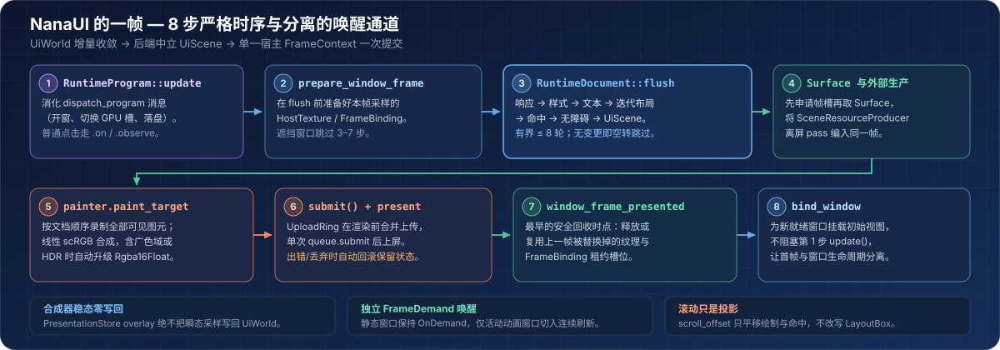

# 一帧的生命周期

一帧的工作是将已经在 `UiWorld` 里的状态变化结算并画上宿主的 Surface。路径始终唯一：应用状态进入 `nana-ui-runtime` 的 `UiWorld`，经 `flush` 抽取为 `nana-ui-scene` 的 `UiScene`，再由 `nana-ui` 的 `SceneWgpuPainter` 录制进宿主的 `FrameContext`（不另开 `Device`，也不回读 CPU）。

在 `run_runtime` 内部，每扇需要重绘的窗口按以下 8 个步骤走完一帧（完整参考见 [框架如何运行](../reference/how-it-works.md)）：

下面按「消息与变更提交」「纹理准备」「flush 事务」「present 与回收」四个阶段说明关键约束。

## 1. 消息与变更提交

控件的普通点击与输入不要绕道 `RuntimeProgram::update`，请直接使用节点上的 `.on` / `.observe` 或信号绑定。只有当点击需要触发开窗、切换 GPU 资源或写盘等宿主级操作时，才在闭包内调用 `cx.dispatch_program(msg)`——该消息会在下一帧开头的第 1 步进入 `update`。`update` 应保持轻量，新窗口的初始页面内容放在 `present` 之后的 `bind_window` 中挂载。

树结构的修改会先进入当前帧的 `MutationQueue`，整批校验通过后才一次性原子提交（commit），绝不会发布半棵树；已销毁节点的 `StableNodeId` 永不复用。

## 2. 纹理准备（`prepare_window_frame`）

`prepare_window_frame` 在 `flush` 之前执行，应用在此处准备好本帧要采样的最新纹理。更换纹理对象或尺寸时只需递增 `HostTexture` 的 `generation`，切勿为了换画面而去销毁或重建 Runtime 节点（详见 [实时画面](./gpu.md)）。

::: tip 遮挡与零尺寸窗口的纹理节拍
当窗口被最小化、遮挡或尺寸为 0 时，只要 `FrameDemand` 到期，宿主仍会调用 `prepare_window_frame`（若尺寸非零，按图离屏生产者仍会在无 Surface 的 `FrameContext` 上编码并立即提交；此处的 `submitted()` 仅代表离屏编码已入队，不代表采样它的 UI 帧已上屏）。但这一拍会跳过 UI `flush`、不获取 Surface、不 `present`，也不调用 `window_frame_presented`。因此**永远不要在 `prepare_window_frame` 里假定后面一定有 `present`；上一帧仍可能被采样的旧纹理必须留到真正的 `window_frame_presented` 之后才能释放**。
:::

## 3. `flush`：样式、文本、布局、命中与抽取

`RuntimeDocument::flush` 在一次有界帧事务中依次完成样式解析、宿主文本整形（`NanaTextShaper`）、增量布局（`RuntimeLayoutEngine`）、命中测试索引更新、无障碍增量投影与 `ExtractedNode` 抽取。若帧事务未收敛或失败，已排出的脏工作会还原回调度器，不会对外发布半成品 Scene 或无障碍增量。

- **无变更即空转**：没有脏节点时 `flush` 直接空转返回，宿主不会为此空刷一帧。动画、实时 GPU 画面与普通界面变更的唤醒通道彼此独立。
- **视口缩放（Viewport Resize）增量布局**：当窗口视口尺寸变化时，即使应用未提交任何树变更也会触发布局。但只有文档根、消费了变化轴约束的子树、`position: fixed` 以及使用 `vw` / `vh` 单位的盒子会重新测量，不依赖视口变化轴的子树直接复用保留的测量缓存与布局计划。
- **滚动不改写布局盒**：滚动偏移（`scroll_offset`）不写回 Runtime 的 `LayoutBox`。
- **合成器动画不写回基础样式**：`UiWorld` 保存逻辑目标值，过渡中的 `transform` / `opacity` 留在 `PresentationStore` overlay 上（弹簧与衰减均按绝对时间戳确定性求值，完成事件靠 deadline 触发而非逐帧采样）。稳态动画帧只推进时间，既不标脏 `UiWorld`，也不触发重新抽取。

## 4. `present`：录制、提交与资源回收

`flush` 完成后，宿主获取当前窗口的 Surface，并将按图生产的外部资源（`SceneResourceProducer`）与 `SceneWgpuPainter::paint_target` 的界面绘制录制进**同一个宿主 `FrameContext`**，在单次提交中一并送入队列：

- **提交与回滚单一权威**：提交（`submit`）与丢弃（`discard` / drop）均由 `FrameContext` 独占负责。一旦编码或绘制出错，整帧立即丢弃，painter 登记在该帧上的保留状态写入会自动回滚；若前一帧画过某个渲染目标但尚未提交也未丢弃，再次绘制该目标会返回 `ScenePaintError::TargetInFlight`。
- **纹理释放时点**：直到 `window_frame_presented` 回调触发后，应用才可以安全释放或复用上一帧被替换下来的纹理。
- **按需刷新与隐藏恢复**：静态窗口保持 `FrameDemand::OnDemand`；当某扇窗口存在活动合成器轨道时，仅将该窗口切入轻量的 `FrameDemand::Continuous`。窗口最小化或被遮挡期间不空跑隐藏 GPU 帧，恢复可见后按绝对时间直接求值；单窗口 Surface 重建只按受影响窗口递增 `UiScene::set_surface_generation`，仅设备丢失全局切换时为所有窗口递增。

## 接着读

  <a class="next-step" href="/architecture/gpu">
    
实时画面

    
纹理如何作为普通节点留在树上并按文档顺序合成。

  </a>
  <a class="next-step" href="/reference/how-it-works">
    
框架如何运行

    
状态归属、宿主接口与 Motion IR 分流全表。

  </a>
  <a class="next-step" href="/reference/runtime-scene">
    
Runtime 与 Scene

    
flush 内部如何抽取图元、处理裁剪与背景模糊。

  </a>

