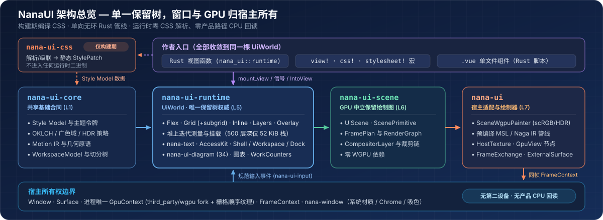

# 架构总览

本板块面向**应用作者**，建立开发 NanaUI 桌面产品所需的核心心智模型。如果你需要查阅 crate 之间的完整边界合同，请见 [架构合同](../reference/architecture.md)；如果你想深入各个 crate 的内部源码与数据流，请进入 [架构学习](/learn/)。

## 一条唯一的产品路径

Rust 的 `view!` 宏、函数式视图以及 `.vue` 方言写的都是同一棵 `UiWorld`——它们是不同的作者入口，而不是第二棵树或第二套绘制器。CSS 解析与级联也只有 `nana-ui-css` 一处实现：`.vue` 的 `<style>`、`stylesheet!` 与 `css!` 在构建时调用它并编译为 Style Model 数据。

应用持有业务状态、路由以及每个区域里的具体内容；框架提供控件语义、布局求解、命中测试、焦点/IME、无障碍增量投影，以及将场景绘制进宿主 Surface 的管线。

## 各层职责分工

| Crate | 核心职责 |
| --- | --- |
| `nana-ui-core` | 共享基础合同：Style Model（Tokens + Semantics + Layout）、OKLCH/Color 4、主题令牌、几何、WorkspaceModel、Motion IR |
| `nana-ui-runtime` | 保留树权威 `UiWorld`、内置控件、纯 `Flex + Grid (+ subgrid) + Inline + Layers + Overlay` 迭代布局引擎、输入路由、焦点、Shell、Workspace、Dock、AreaLayout |
| `nana-ui-scene` | 绘制图权威 `UiScene` 与 `FramePlan`（依赖 runtime，不依赖 WGPU） |
| `nana-ui` | 宿主适配器、`run_runtime` 与 `SceneWgpuPainter`（预编译 MSL / Naga IR 管线、线性 scRGB / HDR `Rgba16Float` 合成） |
| `nana-ui-css` | 唯一的样式表解析与级联引擎（仅构建期运行，不进入 core / runtime / scene / nana-ui） |
| `nana-text` | 产品唯一的文本测量、OpenType 整形与保留文本布局权威 |
| `nana-ui-charts` | ECharts 风格图表模型、刻度、布局与 GPU 标记数组（仅依赖 `nana-ui-core`） |
| `nana-ui-diagram` | 原生 Mermaid 图表引擎：支持全部 34 种图表类型（仅依赖 `nana-ui-core` 与 `nana-ui-charts`） |
| `nana-ui-input` | 规范输入事件、序列器与 `HostServices` 合同（Runtime 路由器是唯一消费方） |
| `nana-gpu` | `GpuContext`、`FrameContext`、`GpuTexture` 合同（WGPU 是唯一正式后端） |
| `nana-window` | 原生窗口句柄、系统材质、标题栏拖拽、客户区 chrome、缩放与屏幕取色（`ColorSampler`） |

普通控件永远拿不到原生窗口句柄（`HWND` / `NSWindow`）。系统材质经由 `nana-window` 申请，失败时如实返回实际生效结果或显式回退。你的应用拥有 `Window`、`Surface`、`GpuContext` 以及每一帧的 `FrameContext`；实时画面通过 `GpuTextureView` 或 `CustomRenderNode` 挂在树上，像普通控件一样参与布局、裁剪、命中测试和文档顺序。

## 逻辑状态与呈现 Overlay 分离

`UiWorld` 保存的是业务可读的**逻辑状态**，而过渡动画期间的瞬时透明度与变换保存在 `PresentationStore` 的呈现 overlay 上。业务代码读取节点属性时拿到的是逻辑目标值；绘制、命中测试、焦点与无障碍则在需要时按同一个时间戳查询呈现值。

::: warning
切勿把合成器动画的瞬时采样写回基础样式——那会把过渡途中的中间值篡改为逻辑状态，还会导致 `UiWorld` 每帧变脏、无法进入合成器稳态。
:::

## 框架明确不内置的事项

NanaUI 不提供整窗浏览器 DOM、内置业务路由栈或服务端渲染。应用内嵌入真实网页仅限显式的宿主原生例外 `BrowserView`（当前支持 macOS `WKWebView`）；无头网页采集则作为宿主内容生产者（`WebSurface`）向应用输出帧。每个工作区区域里放什么内容、导航怎么跳转，均由应用自行放进壳层槽位。

## 接着读

  <a class="next-step" href="/architecture/frame">
    
一帧

    
从输入与消息到画上窗口 Surface 的完整 8 步。

  </a>
  <a class="next-step" href="/architecture/gpu">
    
实时画面

    
宿主纹理与自定义渲染节点如何留在同一棵树上。

  </a>
  <a class="next-step" href="/architecture/text">
    
文本

    
字体选择、整形与保留在树上的文本布局。

  </a>
  <a class="next-step" href="/architecture/window">
    
窗口

    
原生窗口、自绘标题栏、系统材质与多窗口。

  </a>
  <a class="next-step" href="/learn/">
    
架构学习（深入源码）

    
按 crate 与子系统拆解框架内部实现与数据流。

  </a>

