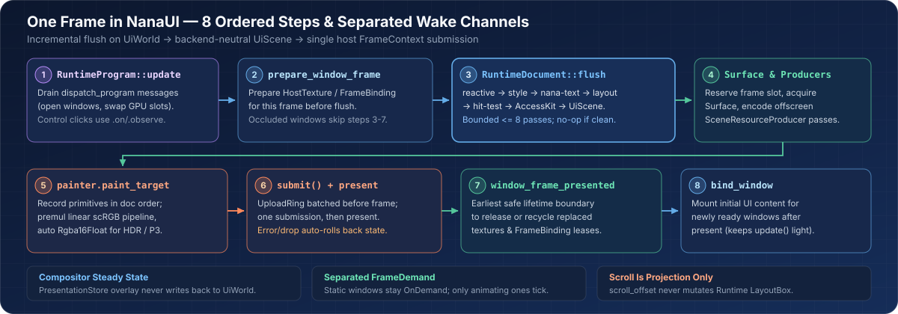

# The Lifecycle of a Frame

A frame's job is to settle the state changes already in `UiWorld` and paint them onto the host's Surface. The path is always the same: application state enters `UiWorld` in `nana-ui-runtime`, `flush` extracts it into `UiScene` in `nana-ui-scene`, and `SceneWgpuPainter` in `nana-ui` records it into the host's `FrameContext` (no extra `Device`, no CPU readback).

Inside `run_runtime`, each window that needs a redraw goes through a frame in the following 8 steps (for the full reference, see [How the framework runs](../reference/how-it-works.md)):

The key constraints are described below in four phases: "Messages and mutation commit", "Texture preparation", "The flush transaction", and "Present and reclamation".

## 1. Messages and mutation commit

Ordinary clicks and input on controls should not detour through `RuntimeProgram::update`. Use `.on` / `.observe` on the node or a signal binding directly. Only when a click needs to trigger a host-level operation, such as opening a window, switching GPU resources or writing to disk, call `cx.dispatch_program(msg)` inside the closure. That message enters `update` in step 1 at the start of the next frame. Keep `update` lightweight, and mount a new window's initial page content in `bind_window`, after `present`.

Tree structure changes first go into the current frame's `MutationQueue`. Only after the whole batch validates is it committed atomically in one go; a half-built tree is never published. The `StableNodeId` of a destroyed node is never reused.

## 2. Texture preparation (`prepare_window_frame`)

`prepare_window_frame` runs before `flush`, and this is where the application prepares the latest textures the frame samples. When you change a texture object or its size, just increment the `HostTexture` `generation`. Never destroy or rebuild Runtime nodes to change what is shown (see [Live GPU content](./gpu.md)).

::: tip Texture cadence for occluded and zero-size windows
When a window is minimized, occluded or has zero size, the host still calls `prepare_window_frame` whenever `FrameDemand` is due. (If the size is nonzero, graph-driven offscreen producers still encode on a `FrameContext` without a Surface and submit immediately; `submitted()` here only means the offscreen encoding is queued, not that the UI frame sampling it has been presented.) But this tick skips the UI `flush`, does not acquire the Surface, does not `present`, and does not call `window_frame_presented`. So **never assume in `prepare_window_frame` that a `present` will follow; an old texture that the previous frame may still sample must be kept until the real `window_frame_presented` before it is released**.
:::

## 3. `flush`: style, text, layout, hit testing and extraction

`RuntimeDocument::flush` runs, in one bounded frame transaction, style resolution, host text shaping (`NanaTextShaper`), incremental layout (`RuntimeLayoutEngine`), hit-test index updates, incremental accessibility projection and `ExtractedNode` extraction. If the frame transaction fails to converge or fails outright, the dirty work already drained is restored to the scheduler, and no half-finished Scene or accessibility delta is published.

- **No changes, no work**: when there are no dirty nodes, `flush` returns immediately and the host does not paint an empty frame for it. Animations, live GPU content and ordinary UI changes have independent wake-up channels.
- **Incremental layout on viewport resize**: when the window's viewport size changes, layout runs even if the application committed no tree changes. But only the document root, subtrees that consumed a constraint on the changed axis, `position: fixed`, and boxes using `vw` / `vh` units are remeasured. Subtrees that do not depend on the changed viewport axis reuse their retained measurement cache and layout plan.
- **Scrolling does not rewrite layout boxes**: the scroll offset (`scroll_offset`) is not written back to the Runtime `LayoutBox`.
- **Compositor animation does not write back to base style**: `UiWorld` holds the logical target value, while in-transition `transform` / `opacity` stay on the `PresentationStore` overlay (springs and decays are evaluated deterministically at absolute timestamps, and completion events fire on deadlines rather than per-frame sampling). Steady-state animation frames only advance time; they neither dirty `UiWorld` nor trigger re-extraction.

## 4. `present`: recording, submit and resource reclamation

After `flush`, the host acquires the current window's Surface, and records graph-produced external resources (`SceneResourceProducer`) together with the UI drawing from `SceneWgpuPainter::paint_target` into **the same host `FrameContext`**, sending them to the queue in a single submit:

- **One authority for submit and rollback**: submit (`submit`) and discard (`discard` / drop) are owned exclusively by `FrameContext`. As soon as encoding or painting fails, the whole frame is discarded immediately, and retained-state writes the painter registered on that frame roll back automatically. If a previous frame painted a render target but has neither submitted nor discarded, painting that target again returns `ScenePaintError::TargetInFlight`.
- **When textures are released**: only after the `window_frame_presented` callback fires can the application safely release or reuse textures replaced in the previous frame.
- **On-demand refresh and hidden recovery**: static windows stay on `FrameDemand::OnDemand`. When a window has an active compositor track, only that window switches to the lightweight `FrameDemand::Continuous`. While a window is minimized or occluded, no hidden GPU frames run; when it becomes visible again it evaluates directly at absolute time. Single-window surface recovery bumps `UiScene::set_surface_generation` only for the recovered window(s), while device-loss recovery bumps every window.

## Read next

  <a class="next-step" href="/architecture/gpu">
    
Live GPU content

    
How textures stay on the tree as ordinary nodes and composite in document order.

  </a>
  <a class="next-step" href="/reference/how-it-works">
    
How the framework runs

    
The full tables for state ownership, host interfaces and Motion IR routing.

  </a>
  <a class="next-step" href="/reference/runtime-scene">
    
Runtime and Scene

    
How flush extracts primitives and handles clipping and backdrop blur internally.

  </a>

