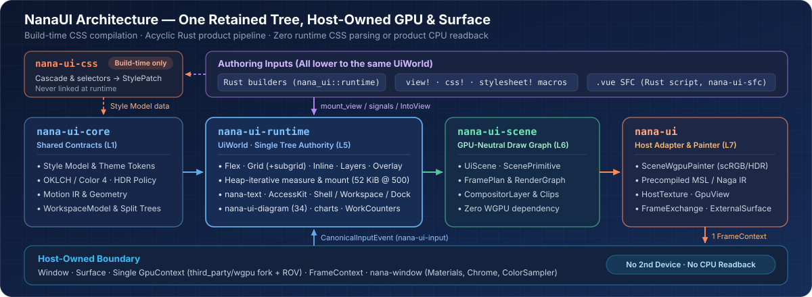

# Architecture Overview

This section is for **application authors**. It builds the core mental model you need to develop desktop products with NanaUI. For the complete boundary contracts between crates, see [Architecture contracts](../reference/architecture.md). To dig into each crate's internal sources and data flow, go to [Learn the architecture](/learn/).

## One product path

Rust's `view!` macro, function views and the `.vue` dialect all build the same `UiWorld`. They are different authoring paths, not a second tree or a second painter. CSS parsing and cascade also have exactly one implementation, `nana-ui-css`: the `.vue` `<style>`, `stylesheet!` and `css!` call it at build time and compile to Style Model data.

The application owns business state, routing and the concrete content of each region. The framework provides control semantics, layout solving, hit testing, focus/IME, incremental accessibility projection, and the pipeline that paints the scene into the host Surface.

## Responsibilities by layer

| Crate | Core responsibility |
| --- | --- |
| `nana-ui-core` | Shared foundation contracts: Style Model (Tokens + Semantics + Layout), OKLCH/Color 4, theme tokens, geometry, WorkspaceModel, Motion IR |
| `nana-ui-runtime` | Retained tree authority `UiWorld`, built-in controls, pure `Flex + Grid (+ subgrid) + Inline + Layers + Overlay` iterative layout engine, input routing, focus, Shell, Workspace, Dock, AreaLayout |
| `nana-ui-scene` | Drawing graph authority `UiScene` and `FramePlan` (depends on runtime, not on WGPU) |
| `nana-ui` | Host adapter, `run_runtime` and `SceneWgpuPainter` (precompiled MSL / Naga IR pipelines, linear scRGB / HDR `Rgba16Float` compositing) |
| `nana-ui-css` | The only stylesheet parse and cascade engine (build-time only; stays out of core / runtime / scene / nana-ui) |
| `nana-text` | The product's only authority for text measurement, OpenType shaping and retained text layout |
| `nana-ui-charts` | ECharts-shaped chart model, scales, layout and GPU mark arrays (depends only on `nana-ui-core`) |
| `nana-ui-diagram` | Native Mermaid diagram engine supporting all 34 diagram kinds (depends only on `nana-ui-core` and `nana-ui-charts`) |
| `nana-ui-input` | Canonical input events, sequencer and `HostServices` contract (the Runtime router is the only consumer) |
| `nana-gpu` | `GpuContext`, `FrameContext`, `GpuTexture` contracts (WGPU is the only official backend) |
| `nana-window` | Native window handles, system materials, title bar dragging, client-area chrome, scaling and screen `ColorSampler` |

Ordinary controls never get a native window handle (`HWND` / `NSWindow`). System materials are requested through `nana-window`; on failure it truthfully returns the outcome that actually applied, or an explicit fallback. Your application owns the `Window`, the `Surface`, the `GpuContext` and each frame's `FrameContext`. Live GPU content hangs on the tree through `GpuTextureView` or `CustomRenderNode` and takes part in layout, clipping, hit testing and document order like any ordinary control.

## Logical state is separate from the presentation overlay

`UiWorld` stores **logical state** that business code can read, while transient opacity and transforms during transitions live in the presentation overlay of `PresentationStore`. When business code reads a node property it gets the logical target value. Painting, hit testing, focus and accessibility query the presentation value at the same timestamp when they need it.

::: warning
Never write a compositor animation's transient sample back into base style. That turns a mid-transition value into logical state, and it also dirties `UiWorld` every frame so the compositor can never reach a steady state.
:::

## What the framework deliberately does not include

NanaUI does not provide a whole-window browser DOM, a built-in business routing stack, or server-side rendering. Embedding a real web page inside the application is limited to the explicit host-native exception `BrowserView` (currently macOS `WKWebView`). Headless web capture is a host content producer (`WebSurface`) that outputs frames to the application. What goes into each workspace region and how navigation works are up to the application, which places that content into shell slots itself.

## Read next

  <a class="next-step" href="/architecture/frame">
    
A frame

    
The full 8 steps from input and messages to the window Surface.

  </a>
  <a class="next-step" href="/architecture/gpu">
    
Live GPU content

    
How host textures and custom render nodes stay on the same tree.

  </a>
  <a class="next-step" href="/architecture/text">
    
Text

    
Font selection, shaping and text layout retained on the tree.

  </a>
  <a class="next-step" href="/architecture/window">
    
Windows

    
Native windows, custom title bars, system materials and multiple windows.

  </a>
  <a class="next-step" href="/learn/">
    
Learn the architecture (source deep dive)

    
The framework's internal implementation and data flow, broken down by crate and subsystem.

  </a>

