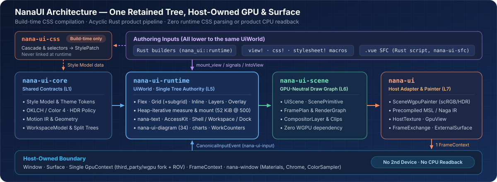

# Introduction

## What is NanaUI?

NanaUI is a retained-mode Rust framework for building native desktop user interfaces. Your application opens the windows and owns the GPU device used for drawing. The framework performs layout (`Flex + Grid (+ subgrid) + Inline + Layers + Overlay`), hit testing and compositing on one UI tree, then draws that tree into the window's Surface.

Buttons, text, sidebars and live GPU content are nodes in the same tree. They share layout, clipping, hit testing and stacking order.

## How it differs from other frameworks

| | Typical approach | NanaUI |
| --- | --- | --- |
| **Web wrappers** (Electron, Tauri, Wry) | Chromium / WebView runs in the window; live GPU content is another process or a separate compositor | No WebView. The UI is one native tree |
| **Game engine HUD** | The scene is the main world; the UI floats on top | GPU content is a node in the tree, laid out, clipped and hit-tested like a Button |
| **Immediate-mode UI** | The UI is rebuilt every frame | Retained tree. No changes, no new frame |
| **Retained UI that owns the GPU** | The framework owns the Device; external content is often a hole or a texture pasted at frame end | The host owns Window / Surface / Device / Queue. GPU content is in document order |

Compared with web wrappers: there is no WebView and no JS runtime. There is also no Tauri-style window, plugin and invoke protocol, and no browser CORS, cookies or Service Workers.

Compared with game engines: the UI itself is the main subject. You draw live content into a texture and attach it to the tree as an ordinary node.

Compared with immediate mode: controls stay in `UiWorld`. If nothing changed, the frame is not redrawn. Events go through `on` / `observe`. Messages that cross windows, GPU work and persistence are handled in `RuntimeProgram::update`.

Compared with retained UIs that own the GPU: NanaUI uses the Device and Queue you already have. Live content is never read back to the CPU and pasted in again. `SceneWgpuPainter` samples `HostTexture` in node order inside the main render pass.

## When to use it

It fits desktop products that need the feel of native windows and where shaders, preview viewports or other live GPU content must sit in the same UI as panels and dialogs.

If you only need to put a website in a window, want an immediate-mode debug panel, or need the full browser and Tauri plugin ecosystem, use a tool from that category.

## Two authoring styles

Rust `nana_ui::runtime` is the default way to author UI. `view!` and function calls are both first-class styles on that path, with equal capabilities, and they expand to the same mount. The toggle at the top of the sidebar only switches the examples; it does not change the runtime.

`.vue` files are an advanced path with their own chapter and are not part of that toggle. Their scripts are also Rust and compile to ordinary view functions at build time.

Routing, what goes in each region, and where settings are stored are owned by your application. The framework provides controls, layout, hit testing, focus and drawing.

## Next steps

  <a class="next-step" href="/guide/quick-start">
    
Quick start

    
Write your first piece of UI.

  </a>
  <a class="next-step" href="/guide/from-vue">
    
Coming from Vue

    
How ref, v-if and v-model are written here.

  </a>
  <a class="next-step" href="/guide/essentials/view">
    
View syntax

    
See how the two styles of the same UI expand.

  </a>
  <a class="next-step" href="/architecture/">
    
Architecture

    
See how this tree gets drawn into a window.

  </a>

