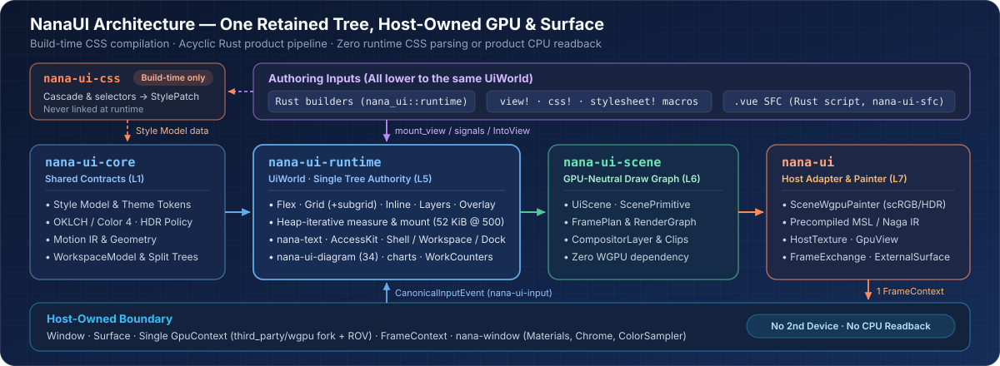

# Architecture Deep Dive

This section is for readers who **want to understand how the NanaUI framework is implemented and why its design choices were made**. It takes the repository apart by module (all 25 crates: 24 workspace members plus standalone `nana-icons-tabler`) and by core subsystem (retained tree, layout, style, text, Scene extraction, GPU and frames, input, windows, toolchain), and drills down to source-level data structures and line-number anchors.



It divides the work with the other sections of the docs site as follows:

| Section | Perspective and audience |
| --- | --- |
| [Guide](/guide/introduction) | Getting started and going further as an application developer: building a window from scratch, reactivity, component composition, hot reload, packaging, and accessibility |
| [Components](/components/) | Catalog of the 89 built-in controls, usage examples (switchable between `view!` and functions), property tables, and event tables |
| [Architecture](/architecture/) | The mental model an application author needs (a frame, live GPU content, text, windows) |
| **Architecture Deep Dive (this section)** | For architecture learners and framework contributors: coverage of all 25 crates + subsystem internals + end-to-end data flow + verification checklists |
| [Reference](/reference/how-it-works) | Complete technical contracts for lookup (application API, declarative views, CSS/Rust layout, window/GPU/windowless output, maintainer notes) |

## The main path in one picture

```text
Rust / `.vue` dialect input
    -> nana-ui-core        shared contracts: Style Model, theme, geometry, Workspace, Motion IR
    -> nana-ui-runtime     UiWorld: retained tree, controls, layout, input, focus, Shell, Dock, AreaLayout
    -> nana-ui-scene       extracted retained drawing graph (no WGPU dependency)
    -> nana-ui             host adapter + SceneWgpuPainter
```

There is exactly one product rendering path: `UiWorld → ExtractedNode → UiScene → SceneWgpuPainter`. Each supporting engine (CSS engine, text engine, input contract, platform and window, GPU contract) has exactly one authoritative implementation in the repository. See [Modules and Layers](/learn/modules-and-layers) and [Contracts and Invariants](/learn/contracts-and-invariants).

## Chapter map

### The big picture

| Chapter | Core content |
| --- | --- |
| [Modules and Layers](/learn/modules-and-layers) | Layer grouping of the 25 crates, the list of 58 normal dependency edges (plus `nana-icons-tabler → nana-ui-core`), layering rules, and verification commands |
| [Contracts and Invariants](/learn/contracts-and-invariants) | Nine non-negotiable architecture contracts, each with "why it is designed this way" and the consequences of violating it |
| [End-to-End Data Flow](/learn/flows) | Four core flows: state change → pixels, click → callback, text → pixels, live GPU content attached to the tree |
| [Reading the Code](/learn/reading-the-code) | Repository map, recommended reading routes, minimal runnable examples, and debugging techniques |

### Foundation contract layer

| Chapter | Core content |
| --- | --- |
| [Core Contracts: nana-ui-core](/learn/core-contracts) | Style Model (Tokens + Semantics + Layout), theme tokens, geometry, WorkspaceModel, Motion IR |
| [CSS Engine: nana-ui-css](/learn/css-engine) | Hand-written lexing/parsing/selector matching/cascade, and its single point of consumption at build time |
| [Text Engine: nana-text](/learn/text-engine) | The three-stage decoupled pipeline of font selection → OpenType shaping → retained text layout, and generational caches |

### Runtime internals

| Chapter | Core content |
| --- | --- |
| [Retained Tree: UiWorld](/learn/runtime-tree) | Dense node table and sparse side tables, atomic batched commit, `ComponentRegistry`, three generation counters |
| [Layout Engine: RuntimeLayoutEngine](/learn/runtime-layout) | Formatting contexts, intrinsic measurement and plan replay, the `LayoutFrontier` dependency graph, scroll extents |
| [Input Path](/learn/runtime-input) | `nana-ui-input` canonical events, endpoint coalescing, the single `route_input` router, focus, IME, and accessibility projection |
| [Workspace: Shell, Workspace, Dock, and Overlay](/learn/workspace-shell-dock) | Desktop shell, region scaling, the recursive Dock tree, AreaLayout, same-transaction focus migration for overlays, and state persistence |

### Rendering and the host side

| Chapter | Core content |
| --- | --- |
| [Scene Extraction](/learn/scene-extraction) | `UiScene` drawing graph structure, `apply_delta` incremental invalidation, `FramePlan` compilation, why it does not depend on WGPU |
| [GPU and Frame Lifecycle](/learn/gpu-frame) | The `nana-gpu` contract, submission order, frame slots, upload ring, `SceneWgpuPainter`, the 35-step total order of a frame |
| [Window and Platform](/learn/window-platform) | The neutral `nana-ui-platform` contract, native execution in `nana-window`, material fallback semantics, headless `WebSurface` |

### Authoring paths and toolchain

| Chapter | Core content |
| --- | --- |
| [Authoring Paths](/learn/authoring-paths) | How the Rust `view!` macro chain and the `.vue` dialect converge into the same `UiWorld` |
| [Authoring Toolchain](/learn/toolchain) | `view-macros` / `view-schema` / `view-codegen`, the `.vue` SFC compiler |
| [Supporting Crates at a Glance](/learn/supporting-crates) | Charts, diagnostics, SVG rasterization, icons, the read and write sides of packaging, hot reload, devtools, and the surrounding ecosystem |

### Appendix

| Chapter | Core content |
| --- | --- |
| [25-Crate Coverage Matrix](/learn/coverage-matrix) | Quick reference for each crate's responsibility, dependency direction, key entry types, and owning chapter |
| [Evidence Checklist](/learn/evidence-checklist) | Read-only verification commands for key architecture claims, readings from actual runs in the current workspace, and source line-number anchors |

## Owning chapter for each of the 25 crates

| Crate | Owning chapter |
| --- | --- |
| `nana-ui-core` | [Core Contracts](/learn/core-contracts) |
| `nana-ui-css` | [CSS Engine](/learn/css-engine) |
| `nana-text` | [Text Engine](/learn/text-engine) |
| `nana-ui-runtime` | [Retained Tree](/learn/runtime-tree) · [Layout Engine](/learn/runtime-layout) · [Input Path](/learn/runtime-input) · [Workspace layer](/learn/workspace-shell-dock) |
| `nana-ui-input` | [Input Path](/learn/runtime-input) |
| `nana-ui-scene` | [Scene Extraction](/learn/scene-extraction) |
| `nana-gpu` | [GPU and Frame Lifecycle](/learn/gpu-frame) |
| `nana-frame-exchange` | [GPU and Frame Lifecycle](/learn/gpu-frame) |
| `nana-ui` | [GPU and Frame Lifecycle](/learn/gpu-frame) · [Authoring Paths](/learn/authoring-paths) |
| `nana-ui-platform` | [Window and Platform](/learn/window-platform) |
| `nana-window` | [Window and Platform](/learn/window-platform) |
| `nana-ui-sfc` | [Authoring Toolchain](/learn/toolchain) |
| `nana-ui-view-macros` | [Authoring Toolchain](/learn/toolchain) |
| `nana-ui-view-schema` | [Authoring Toolchain](/learn/toolchain) |
| `nana-ui-view-codegen` | [Authoring Toolchain](/learn/toolchain) |
| `nana-ui-charts` | [Supporting Crates at a Glance](/learn/supporting-crates) |
| `nana-ui-diagram` | [Supporting Crates at a Glance](/learn/supporting-crates) |
| `nana-diagnostics` | [Supporting Crates at a Glance](/learn/supporting-crates) |
| `nana-svg-raster` | [Supporting Crates at a Glance](/learn/supporting-crates) |
| `nana-app-icon` | [Supporting Crates at a Glance](/learn/supporting-crates) |
| `nana-icons-tabler` | [Supporting Crates at a Glance](/learn/supporting-crates) |
| `nana-package` | [Supporting Crates at a Glance](/learn/supporting-crates) |
| `nana-packager` | [Supporting Crates at a Glance](/learn/supporting-crates) |
| `nana-ui-dev` | [Supporting Crates at a Glance](/learn/supporting-crates) |
| `nana-ui-devtools` | [Supporting Crates at a Glance](/learn/supporting-crates) |

## Three recommended reading routes

- **Start from the bird's-eye view**: [Modules and Layers](/learn/modules-and-layers) → [Contracts and Invariants](/learn/contracts-and-invariants) → pick the subsystem chapters that interest you → [End-to-End Data Flow](/learn/flows).
- **Start from rendering one frame**: [End-to-End Data Flow](/learn/flows) (Flow 1: state → pixels) → [Retained Tree](/learn/runtime-tree) → [Scene Extraction](/learn/scene-extraction) → [GPU and Frame Lifecycle](/learn/gpu-frame).
- **Start from a specific crate**: look up its responsibility and key entry types in the [25-Crate Coverage Matrix](/learn/coverage-matrix), jump to its owning chapter, then follow the data flow to see how it works with upstream and downstream crates.
