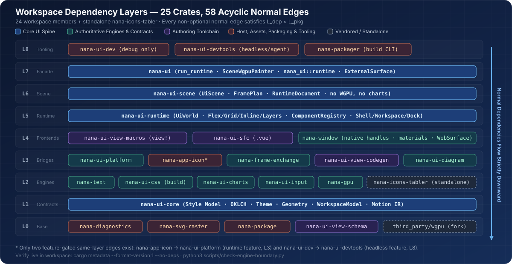

# Modules and Layers

This chapter answers three basic questions: **which layer each of the 25 crates under `crates/` (24 workspace members + standalone `nana-icons-tabler`) sits in**, **how dependency edges flow in one direction**, and **how to verify the layering yourself with a single command**. After reading it you should be able to draw the dependency map of the whole repository in your head and decide at once whether a new dependency should be added.

Layering in NanaUI is not formalism. It uses compile-time visibility to hold three lines: **there is only one authoritative retained tree**, **each supporting engine has only one implementation**, and **the core tree and the scene are neutral to the graphics backend**. Once a dependency direction is inverted, a second authority follows.

## Key conclusions

The normal dependencies across the 25 crates under `crates/` all flow one way, from upper layer to lower layer, and are **strictly acyclic**. The product rendering path has four layers:

```text
nana-ui-core → nana-ui-runtime → nana-ui-scene → nana-ui
  shared contracts  retained-tree authority  retained drawing graph  host adapter + SceneWgpuPainter
```

- The dependency table of `nana-ui-core` contains no `runtime`, `scene`, or `nana-ui`.
- The dependency table of `nana-ui-scene` contains no `nana-ui`, no `nana-ui-charts`, and no GPU crate.
- The whole dependency graph sorts topologically; there are no cycles.

`dev-dependencies` used only for unit tests and benchmarks have a few edges that point "up" to the host layer. They are listed separately in [Dev edges and exceptions](#dev-edges-and-exceptions) at the end and take no part in the layering of product binaries.

## How to verify with a command

All layering readings come from one standard command run at the workspace root:

```bash
cargo metadata --format-version 1
```

`resolve.nodes` and package manifests in the output list each package's declared and resolved dependencies along with `dep_kinds` (which distinguish `normal`, `dev`, and `build` precisely). Filtering the `normal` dependency edges from the 24 workspace members to path packages inside `crates/` yields the repository's **58 workspace-member normal dependency edges** (57 among the 24 member crates + 1 optional edge `nana-ui → nana-icons-tabler`, plus standalone `nana-icons-tabler → nana-ui-core`).

## Dependency level table (Level 0 → Level 8)



The table below groups crates by dependency depth and satisfies one strict invariant: **every non-optional normal dependency edge points to a crate with a smaller level number**. The only two same-level dependencies are both feature-gated optional dependencies: `nana-app-icon → nana-ui-platform` (level 3, `runtime` feature, `crates/nana-app-icon/Cargo.toml:14,22`) and `nana-ui-dev → nana-ui-devtools` (level 8, `headless` feature, `crates/nana-ui-dev/Cargo.toml:20,36`).

| Level | Crate | Direct in-workspace dependencies (normal) | Core role |
| --- | --- | --- | --- |
| 0 | `nana-diagnostics` | — | Framework diagnostics foundation: `event!` / `metric!` / `fault!` / `span!` |
| 0 | `nana-svg-raster` | — | CPU-side SVG rasterization utility |
| 0 | `nana-package` | — | Runtime read-only model of resource packs (`.nrpack`) and manifests |
| 0 | `nana-ui-view-schema` | — | The single schema table of built-in controls for declarative views |
| 1 | `nana-ui-core` | `nana-diagnostics` | Shared foundation contracts: Style Model, theme, geometry, WorkspaceModel, Motion IR, `WorkCounters` |
| 2 | `nana-text` | `nana-ui-core` | Text measurement, OpenType shaping, glyph placement/optional rasterization, and retained text layout (the product's single layout authority for text) |
| 2 | `nana-ui-css` | `nana-ui-core` | The single implementation of CSS parsing, selector matching, and cascade |
| 2 | `nana-ui-charts` | `nana-ui-core` | Chart model, scales, and GPU mark arrays |
| 2 | `nana-ui-input` | `nana-ui-core`, `nana-diagnostics` | Canonical input events, sequencer, bounded endpoints, and `HostServices` |
| 2 | `nana-gpu` | `nana-diagnostics` | GPU backend contract: `GpuContext` / `FrameContext` / `GpuTexture` |
| 2 (standalone) | `nana-icons-tabler` | `nana-ui-core` (path dependency, not a workspace member) | Generated catalog of Tabler vector icon constants |
| 3 | `nana-ui-platform` | `nana-ui-core`, `nana-ui-input`, `nana-diagnostics` | Platform-neutral window, path normalization, and screen color-sampler contract (also re-exports input) |
| 3 | `nana-app-icon` | `nana-ui-platform` (optional, `runtime` feature) | Default application icon and icon encoding for three platforms |
| 3 | `nana-frame-exchange` | `nana-gpu` | Cross-thread bounded latest-frame exchange pool |
| 3 | `nana-ui-view-codegen` | `nana-ui-core`, `nana-ui-css`, `nana-ui-view-schema` | Code generator for `view!` and `.vue` (invokes the CSS engine at build time) |
| 3 | `nana-ui-diagram` | `nana-ui-core`, `nana-ui-charts` | Native Mermaid diagram engine: 34 families (`DiagramKind::ALL`) parsing, layered layout, and theme-neutral vector display lists |
| 4 | `nana-window` | `nana-ui-core`, `nana-ui-platform` | Native window handles, system materials, client-area chrome, scaling, parented auxiliary windows, `WebSurface` |
| 4 | `nana-ui-view-macros` | `nana-ui-view-codegen` | `view!` / `css!` / `stylesheet!` procedural macros |
| 4 | `nana-ui-sfc` | `nana-ui-view-codegen` | Build-time compiler for `.vue` single-file components (Rust script) |
| 5 | `nana-ui-runtime` | `nana-diagnostics`, `nana-ui-core`, `nana-text`, `nana-ui-input`, `nana-ui-view-schema`, optional `nana-ui-charts` / `nana-ui-diagram` / `nana-ui-view-macros` | **The `UiWorld` retained-tree authority**, built-in controls, 5-context layout engine, input routing, Shell/Dock/AreaLayout |
| 6 | `nana-ui-scene` | `nana-diagnostics`, `nana-ui-core`, `nana-ui-runtime`, optional `nana-text` (benchmark) | `UiScene` retained drawing graph and `FramePlan` (no WGPU, no `nana-ui-charts`) |
| 7 | `nana-ui` | Required: `nana-diagnostics`, `nana-text`, `nana-ui-core`, `nana-ui-platform`, `nana-ui-runtime`, `nana-ui-scene`; Optional: `nana-app-icon`, `nana-frame-exchange`, `nana-gpu`, `nana-icons-tabler`, `nana-package`, `nana-svg-raster`, `nana-ui-charts`, `nana-window` | Host adapter, `SceneWgpuPainter`, `run_runtime` (`default = []`) |
| 8 | `nana-packager` | `nana-app-icon`, `nana-package` | CLI for application packaging and tamper-check verification |
| 8 | `nana-ui-dev` | `nana-ui`, `nana-ui-core`, optional `nana-ui-devtools` / `nana-ui-sfc` | Development-time hot reload tool (debug builds only) |
| 8 | `nana-ui-devtools` | `nana-ui-core`, optional `nana-gpu` / `nana-ui` / `nana-ui-platform` / `nana-ui-scene` | Development-time structured diagnostic recording and headless Agent sessions |

::: tip The level number is dependency depth, not "importance"
`nana-ui-core` sits at level 1, yet it is the most central data contract in the framework. A larger level number means the crate is closer to the host assembly layer and the application entry point.
:::

## Five functional groups

1. **Product rendering path (the skeleton of a frame)**: `input (Rust / `.vue` dialect) → nana-ui-core → nana-ui-runtime → nana-ui-scene → nana-ui → host Surface`.
2. **Supporting engines and domain models (each a single authority)**:
   - Text engine: `nana-text` (measured by `runtime`, painted/rasterized by `nana-ui`).
   - CSS engine: `nana-ui-css` (consumed only by the build-time `view-codegen`; `runtime`, `scene`, and `nana-ui` do not depend on it).
   - Chart model: `nana-ui-charts` (consumed by `runtime`, `diagram`, and the `nana-ui` pipelines; removed from `scene`).
   - Mermaid diagram engine: `nana-ui-diagram` (pure CPU parsing/layout/vector display lists, consumed by `runtime` under `rich-text`).
   - Input contract: `nana-ui-input` (re-exported through `platform`, routed by `runtime` as its only consumer).
   - GPU contract: `nana-gpu` (consumed by `nana-ui`, `frame-exchange`, and `devtools`).
   - Native windows: `nana-window` (built on `core` + `platform` at L4, called only by the `nana-ui` host layer).
3. **Declarative view compilation toolchain**: `nana-ui-view-schema` → `nana-ui-view-codegen` → `nana-ui-view-macros` and `nana-ui-sfc` (see [Authoring Toolchain](/learn/toolchain)).
4. **Assets, icons, and packaging for distribution**: `nana-svg-raster`, `nana-app-icon`, `nana-icons-tabler`, `nana-package` (runtime read side), `nana-packager` (build-time write side).
5. **Development and automated verification tools**: `nana-ui-dev` (hot reload), `nana-ui-devtools` (headless Agent sessions and pixel/semantic snapshots).

## Complete list of the 58 workspace-member normal dependency edges

```text
nana-diagnostics     → (no workspace dependencies)
nana-svg-raster      → (no workspace dependencies)
nana-package         → (no workspace dependencies)
nana-ui-view-schema  → (no workspace dependencies)
nana-icons-tabler    → nana-ui-core (path dependency of a non-member, outside the 58 member edges; trimmed by the linker by reference)
nana-ui-core         → nana-diagnostics
nana-text            → nana-ui-core
nana-ui-css          → nana-ui-core
nana-ui-charts       → nana-ui-core
nana-ui-input        → nana-ui-core, nana-diagnostics
nana-gpu             → nana-diagnostics
nana-ui-platform     → nana-ui-core, nana-ui-input, nana-diagnostics
nana-app-icon        → nana-ui-platform (optional, feature `runtime`)
nana-frame-exchange  → nana-gpu
nana-ui-view-codegen → nana-ui-core, nana-ui-css, nana-ui-view-schema
nana-ui-diagram      → nana-ui-core, nana-ui-charts
nana-window          → nana-ui-core, nana-ui-platform
nana-ui-view-macros  → nana-ui-view-codegen
nana-ui-sfc          → nana-ui-view-codegen
nana-ui-runtime      → nana-diagnostics, nana-ui-core, nana-text, nana-ui-input, nana-ui-view-schema,
                       nana-ui-charts (optional), nana-ui-diagram (optional), nana-ui-view-macros (optional)
nana-ui-scene        → nana-diagnostics, nana-ui-core, nana-ui-runtime,
                       nana-text (benchmark feature, optional)
nana-ui              → nana-diagnostics, nana-text, nana-ui-core, nana-ui-platform, nana-ui-runtime, nana-ui-scene,
                       nana-app-icon (optional), nana-frame-exchange (optional), nana-gpu (optional),
                       nana-icons-tabler (optional), nana-package (optional), nana-svg-raster (optional),
                       nana-ui-charts (optional), nana-window (optional)
nana-packager        → nana-app-icon, nana-package
nana-ui-dev          → nana-ui, nana-ui-core, nana-ui-devtools (optional, feature `headless`),
                       nana-ui-sfc (optional, feature `templates`)
nana-ui-devtools     → nana-ui-core, nana-gpu (optional), nana-ui (optional),
                       nana-ui-platform (optional), nana-ui-scene (optional)
```

## Dev edges and exceptions

The following `dev-dependencies` serve only each crate's own integration tests and benchmarks and never enter any product build artifact:

```text
nana-text           → nana-ui-core (dev, bundled-fonts test corpus)
nana-ui-scene       → nana-text, nana-ui-core, nana-ui-input (dev, building benchmarks and scene tests)
nana-packager       → nana-ui-platform (dev)
nana-ui-dev         → nana-ui-platform, nana-ui-runtime, nana-ui-scene (dev)
```

## Three rules of thumb for learners

1. **To find the authoritative implementation of something, look at the dependency table first**: `nana-ui-runtime` depends on `nana-text` and not the other way around, so the text layout authority is `nana-text`. `nana-ui` sits at level 7 and depends on every subsystem, so it is the host assembly layer, not the authority for the tree or for style.
2. **A reverse dependency breeds a second authority**: if `nana-ui-core` ever depended on `nana-ui-runtime`, the foundation contract layer would couple to the internal structure of the retained tree and the layering barrier would fail.
3. **A crate's level determines what it can see**: `nana-ui-css` at level 2 cannot see the tree or windows, so it cannot quietly measure containers inside the CSS engine. `nana-ui-scene` at level 6 cannot see `nana-gpu`, so the drawing graph is decoupled from WGPU by construction.

## Read next

- [Contracts and Invariants](/learn/contracts-and-invariants): the nine core architecture contracts that the layering protects
- [25-Crate Coverage Matrix](/learn/coverage-matrix): quick reference for each crate's key entry types and source anchors
- [Architecture Contracts (Reference)](/reference/architecture): the full boundary contracts for maintainers
