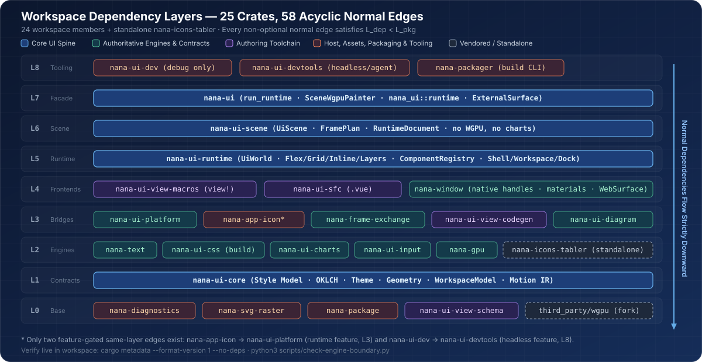

# Architecture contract

This page is for contributors who develop and maintain the NanaUI framework. It fixes the responsibility boundaries and object ownership of each crate in the workspace, so that evolution does not grow a second tree, a second renderer, or a second GPU device.

- If you are building a desktop application with NanaUI, read [How the framework runs](how-it-works.md) and [Quick start](../guide/quick-start.md) first.
- To study the internal implementation of each subsystem by module and source line, read the [Architecture study](/learn/) section.
- For the consumer-side contracts of the workspace, windows, live GPU content, and built-in controls, see [Workspace](workspace.md), [Window](window.md), [Live GPU content](gpu.md), and [Controls](components.md).

## Crate boundaries and dependency direction



```text
Application / Demo
    │
    ▼
nana-ui                  Host adapter: run_runtime, control re-exports, SceneWgpuPainter,
    │                    FrameBinding, off-window output ExternalSurface (gpu feature)
    ├── nana-gpu         GPU backend contract: GpuContext (device, generation, capabilities, loss state, textures and submission order),
    │                    FrameContext (single-frame context owning the encoder), GpuTexture.
    │                    WGPU is the only backend; wgpu-interop is the explicit escape hatch
    ├── nana-frame-exchange  Cross-thread latest-frame exchange (built on nana-gpu and re-exports the contract types;
    │                        producer-side render libraries depend only on it, not on nana-ui)
    ├── nana-ui-runtime  Retained tree authority (UiWorld), built-in controls, layout engine, input routing,
    │                    Shell, Workspace, Dock, AreaLayout, GPU slot declarations (no WGPU dependency)
    ├── nana-ui-scene    Draw graph authority (UiScene) and frame graph (FramePlan) (depends on runtime, not on WGPU)
    ├── nana-ui-charts   Chart model: ChartOption, scales, layout, hit data and GPU mark arrays (depends only on nana-ui-core)
    ├── nana-ui-diagram  Mermaid diagrams: parsing, layout and a theme-neutral vector display list (depends on nana-ui-core and nana-ui-charts scales)
    ├── nana-ui-core     Shared foundation contracts: Style Model, theme tokens, WorkspaceModel, Motion IR, geometry
    ├── nana-ui-platform Platform-neutral window contracts (WindowId, descriptors, events, commands, monitors) and re-exports the input contract
    └── nana-window      Native window handles, system materials, title bar dragging, client-area chrome, scaling and fullscreen

Text engine (the product's only layout authority)
    nana-text            Text IR, stable generational IDs, font layer (registration/generations/matching/variation axes/coverage fallback),
                         shaping (segmentation/BiDi/HarfRust/ShapeCache), line layout (single-line fast path/UAX #14 line breaking/
                         visual reordering/line box metrics/alignment/ellipsis/LayoutCache) and retained layout handles (TextLayoutStore).
                         Measuring and painting share the single in-process engine (nana-ui/text_engine.rs):
                         nana_text.rs (NanaTextShaper) measures, scene_paint/text/ paints.
                         See [Text engine](text-engine.md)

Icon catalog (optional, built separately, not among workspace members)
    nana-icons-tabler    All Tabler outline Icon constants (generated by scripts/generate_tabler_catalog.py).
                         Applications reference constants directly; unreferenced icons are stripped by the linker; not part of the product painting core
```

Mainline dependencies flow one way: `nana-ui` depends on `nana-ui-scene` and `nana-ui-runtime`; `nana-ui-scene` depends on `nana-ui-runtime` (without depending on `nana-ui-charts` or WGPU); `nana-ui-runtime` (`charts`), `nana-ui-diagram`, and `nana-ui` (`charts`) depend on `nana-ui-charts`, which is built only on `nana-ui-core`. The `rich-text` control family of `nana-ui-runtime` additionally brings in `nana-ui-diagram`, and Scene sees only the `PaintRecording` it records. `nana-ui` and `nana-frame-exchange` depend on `nana-gpu`. `SceneWgpuPainter` lives in `nana-ui`, is built on the host's `GpuContext`, and paints into the host's `FrameContext` every frame.

### Windowless output and boundary guard script

The OS window is not the only semantic root of the output API: Window and the windowless `PresentationDriver` share the real presentation orchestration. Plain Window-only output paints directly into the Surface; `RenderTargetPlanner` caches compatible groupings when consumers or display requirements change, so compatible Window/external consumers share one canonical render and only the final transfer is counted separately; incompatible requirements such as pixel density, text AA, and HDR are grouped explicitly. `ExternalSurface` keeps bounded GPU slots and real submission leases for windowless, nested, and headless consumers: static producers skip rendering and submission, and consumers sample only completed versions. The whole path still has exactly one `UiWorld → UiScene` and a same-device `SceneWgpuPainter`, and the product provides no CPU readback fallback (see [Off-window output](output.md)).

`scripts/check-engine-boundary.py` statically guards the following boundaries in CI:

1. **Backend neutrality and `wgpu` signature isolation**: keeps `nana-ui-runtime` and `nana-ui-scene` neutral toward the graphics backend; the public signatures of `nana-gpu`, `nana-frame-exchange`, `nana-ui`, and `nana-ui-devtools` may contain `wgpu::*` only under the `wgpu-interop` feature; `nana_gpu::__framework` is only for use inside those framework crates' own sources (see [Live GPU content](gpu.md#gpu-contracts-and-the-wgpu-escape-hatch)).
2. **Layout vocabulary allowlist**: `nana-text` imports from `nana-ui-core` only the allowlisted layout and dynamic layout cost vocabulary (variation axes, letter spacing, line breaking, alignment, direction, writing mode, line height, CJK punctuation compression, and `dynamic_layout`).
3. **Single text engine**: the retained text node revisions, graded dirty maps, and `TextLayout` handles of `nana-ui-runtime` all take `nana-text` as the only authority; `cosmic-text`, `cryoglyph`, and `glyphon` (including renamed forks) have been removed entirely from `Cargo.lock`, and no workspace member may introduce a non-dev dependency edge leading to them.

## Core product path and the Motion IR contract

There is exactly one product rendering path:

```text
nana_ui::runtime → UiWorld → ExtractedNode → UiScene → SceneWgpuPainter
```

### Separating logical state from the presentation overlay

All animation intent compiles into `nana-ui-core::motion` (Motion IR). Runtime's `AnimationSpec` (with id, target, start, duration, frame_interval, easing, iteration, direction, fill, pause) is a subset of the same timing and playback model, not a second timeline:

- **`UiWorld` is the only authority for logical and base style state.** Transient presentation values during a transition are held in the transient `PresentationStore` overlay and queried by "node + property" (`applied_value()` is used when `applies = false`). For example, when `opacity: 0 → 1` starts, the node's logical opacity is immediately the target value `1`; the overlay carries the transition, and `0.01`, `0.02` are never written into `UiWorld` frame by frame. Business code reading a property gets the logical state; painting, hit testing, focus, and accessibility compute the presentation value at the same timestamp when they need it.
- **Completion events and end-value hold**: animation completion is driven by the start and end **deadline**, not by per-frame CPU sampling to detect the end. After a track with `fill: forwards` ends, its end value stays on the overlay as a **hold**:
  - In Rust L3's `transition()`, `motion(Spring)`, and `Timeline` (`MotionLayer::Runtime`), the hold lasts until the property is next written with **a different logical value**; a component reprojecting and writing back the same value is not a new write and does not interrupt the hold.
  - Any hold can be cleared by restarting with the same ID, by `StopAnimation` (which also works on a finished hold), or by removing the node. CSS `transition` leaves no hold, because the cascaded style itself is the end point.
- **Value validation and out-of-range clamping**: a track's target value and keyframes are strictly validated against the style rules at commit; out-of-range or non-finite values return `InvalidAnimation` directly (for example `opacity` outside `0..=1` or a negative `width`; the framework does not silently clamp for the caller). The start value only has to be finite (an interrupted spring or overshoot track may currently be out of range). Sampling between the start and end is not clamped, preserving the intentional overshoot of bounce curves and springs; consumers finally clamp to the presentable range (the CPU/GPU compositor clamps `opacity` to `0..=1`, `width`/`height`/`padding` have a lower bound of `0`, and font variation axes are clamped by `nana-text` to the font's own axis range).
- **Priority among multiple tracks on the same property**: when several active tracks exist on the same property, a single winner is chosen by `MotionLayer` (`CSS transition > Runtime > CSS animation`, consistent with the CSS cascade), then start time (`start`), then track `id`. Tracks are not blended.

### Animated property execution classes

`AnimationClass::Compositor` properties must never be implemented by modifying `UiWorld` every frame. Compositor tracks are additionally compiled into a generational `MotionDescriptor` table (descriptors are updated only on start, retarget, and cancel), and steady-state frames only run `evaluate_track` by timestamp. The default class is fixed by `AnimatableProperty::animation_class()`:

| Property | Default class | Execution path | Fallback and performance boundary |
| --- | --- | --- | --- |
| `transform` / `opacity` | `Compositor` | Presentation overlay; Quads go through GPU `evaluate()`, non-Quads through the CPU overlay | Steady state does not write `UiWorld`; non-Quads are still presented on the CPU |
| `clip` / `clip-path` | `Compositor` | Presentation overlay; the Painter currently passes only the `motion_id` of transform / opacity to shaders | Steady state does not write `UiWorld`; clip presentation goes through the CPU overlay |
| `shader-parameter` | `Compositor` | Presentation overlay (requires a registered typed codec) | No default Quad GPU path |
| `color` / `background` / `blur` / `filter` / `shadow` | `Paint` | CPU interpolation | Each sample may mark paint / extract dirty; no GPU filter track |
| `width` / `height` / `padding` / `margin` | `Layout` | CPU layout evaluation, writes back pixel sizes | Each sample triggers a partial layout; must never be swapped for a `scale` transform |
| `font-size` | `Layout` | Non-compositor path (affects layout and painting) | Not forced onto the GPU |
| `font-variation-settings` (`FontAxis(tag)`, one track per axis) | `Layout` | Tracks are stored in `PresentationStore`; during style resolution they are layered into the computed style's `font_variations` and inherited downward (subtrees that declare that axis explicitly are unaffected); the `SHAPE_STYLE` dirty map triggers reshaping, layout, and rasterization (zero work if the sampled value is unchanged) | Every effective sample is a real glyph instance and must never be replaced by geometric scaling ([#85](https://github.com/sena-nana/NanaUI/issues/85)). Axes the font lacks are timed as usual but have no effect; this is reported through the `ineffective_reason` of `inspect_motion` and a `nana.css` warning, and is not mapped to `wght` |
| `display` | `Discrete` | Discrete jump (snap) | No interpolation |

The compositor steady-state performance gate (with no queries, the `UiWorld`, layout, style, extraction, and CPU sampling counts are all 0) is defined as `compositor-steady` in [`perf/README.md`](https://github.com/sena-nana/NanaUI/blob/main/perf/README.md). Development-time diagnostics are available through `AnimatableProperty::diagnostic_hint()` and `UiWorld::inspect_motion()`; hint text is not written into product UI.

## Global object ownership table

| Object / state | Authoritative owner | Boundary notes |
| --- | --- | --- |
| `Window`, `Surface` | Host (`run_runtime`, or the embedder of `EmbeddedRuntime`) | The framework borrows per window; ordinary controls may not touch native handles |
| Device: `GpuContext` (generation, capabilities, loss state, submission order) | Host | Sticky loss is recorded in `GpuContext::is_lost()`; replacing the device means creating a new `GpuContext` (new `DeviceGeneration`). The dependency graph holds one wgpu: NanaUI's fork in `third_party/wgpu` (upstream package names and version 30.0.1 kept) |
| Single frame: `FrameContext` (encoder, submit and discard) | Host | The Painter and resource producers only record commands into it; when a frame is dropped/discarded, retained writes registered by the Painter roll back automatically |
| Cross-thread frame slot pool (`FrameExchange`) | Producer thread | The window side samples through `FrameInbox` / `FrameBinding`; declared color space metadata travels with the lease, and consumers must not treat PQ/HLG/P3 as sRGB or linear scRGB without conversion |
| Business state, application configuration, region and pane **content** | Application | The framework holds no business routing or domain data |
| Optional window / Dock view state restoration | `ViewStateStore` | The application specifies a stable scope / key |
| Persistence to disk (`PersistenceCoordinator`) | Host background thread merges disk writes | A program gets a `ProgramStore` through `RuntimeProgramContext::store()`: `flush` only requests a write as soon as possible without blocking, and `clear` only clears the application namespace without touching `nana.*` framework keys; on close the host performs a bounded final flush of at most 2 s (a timeout records `persistence.flush_timed_out`) |
| Retained tree, style, unscrolled layout, hit testing, focus, IME, accessibility | `UiWorld` (`nana-ui-runtime`) | The only UI tree authority |
| Motion IR (curves, timing, classes, evaluation, `PresentationStore`, `MotionDescriptor` table) | `nana-ui-core::motion` | Built-in control motion, L3 transitions, and CSS motion share one timeline |
| Draw graph and compositor layers | `UiScene` (`nana-ui-scene`) | `CompositorLayer` holds presentation and `CompositorMotionBinding`; `SceneWgpuPainter` uploads the descriptor storage buffer and time uniform |
| System materials and native title bar chrome | `nana-window` | Failure returns the actual applied result or an explicit fallback |
| Workspace region sizes and collapse transitions | `WorkspaceModel` (`nana-ui-core`) | `WorkspaceController` only converts pointer and clock input |
| Dock tree | Runtime `DockWorkspace` | `nana_ui::dock::*` is only a host adapter |

## Input entry points and the host content boundary

Rust declarative views (`nana_ui::runtime` builders and `view!`) and the `.vue` dialect (compiled to Rust by `nana-ui-sfc` at build time) lead to the same Style Model (Tokens + Semantics + Layout) and the same `UiWorld`, not two independent runtimes:

- **Single component registration ABI**: built-in and extension controls share the same `ComponentRegistry` and `register_component`. `ComponentSupport` is not an instantiation ABI.
- **`BrowserView` and `WebSurface` boundaries**:
  - `BrowserView` is an explicit host-native child view exception: the Runtime node still owns layout, accessibility, visibility, and the lifecycle anchor, while the host creates and manages the native `WKWebView` child view (currently macOS only; Windows and Linux return an explicit `Unsupported` and create no placeholder browser). It is not equivalent to `GpuTextureView` and does not appear in Runtime/Scene offscreen screenshots; when it meets a non-rectangular clip, an opacity/filter group, or is occluded by later Runtime content, the host hides it automatically.
  - A headless `WebSurface` is a host content producer: the page enters no window's view tree, and captured frames leave the framework through the application's sink (the platform implementation is in `nana-window`, supporting macOS `WKWebView` and Windows WebView2; `nana-ui` reconciles instances against requests).
  - The box model parity tool `tools/css-parity-webview` lives outside the workspace and must never be linked into any product crate.

## Cargo features and compile boundaries

`nana-ui` sets `default = []` (no features are enabled by default): opening a desktop window requires explicitly enabling `hosted` (which implies `gpu` and pulls only the platform's primary graphics backend); enable `wgpu-backends` if you need all standard cross-platform backends, or enable `full`. It never creates a second host or GPU owner.

Control family features (`calendar`, `charts`, `controls`, `graph-canvas`, `image-viewer`, `rich-text`) control conditional compilation of `nana-ui-runtime` and `nana-ui-scene` together and determine `ComponentSupport::compiled`. Disabled control families and their dedicated dependencies are not compiled, and `nana_ui::runtime` exports only the controls actually compiled into the current build (for the full table, see [Application API](application-api.md)). `component-gallery` is a separate example crate; its category navigation and demo state are not part of the public API of `nana-ui`.
