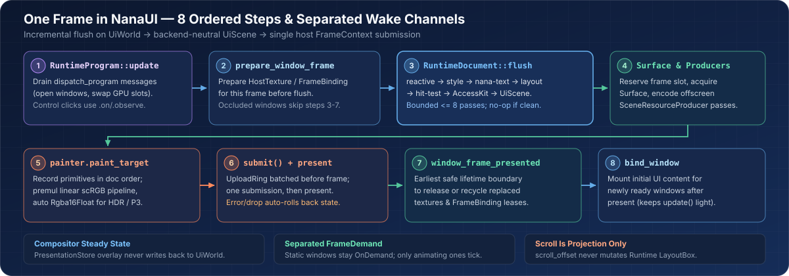

# How the Framework Works

This page establishes NanaUI's core runtime model. After reading it, you should be able to answer three questions clearly: **where application state lives**, **in what order the layers cooperate within a frame**, and **how live GPU content joins the UI tree as an ordinary node**.

For concrete function signatures, see [Application API](application-api.md). For the low-level extraction details of the retained tree and the paint graph, see [Runtime and Scene](runtime-scene.md).

## Three core facts

1. **The UI is a retained tree.** `Text`, `Button`, sidebars, dialogs, and live GPU content are all nodes in the tree. The framework maintains this tree and handles layout, hit testing, focus management, and painting; the application never hand-writes control pixel coordinates.
2. **The window and the GPU belong to the host (your application).** The application holds the `Window`, `Surface`, `Device`, and `Queue` (the default host managed by `run_runtime` follows the same ownership). NanaUI only records draw commands into the host's frames: it neither creates a second GPU device nor reads content back to the CPU to paste it onto the GPU again.
3. **Live content is a first-class tree node.** Shader output or a preview viewport is neither a "hole" cut in the window nor a HUD overlay drawn on top of the UI. Like a `Button`, it takes layout space, is clipped by its parent container, can be occluded by later nodes, receives clicks by the same hit rules, and composites strictly in document order.

## Responsibilities and ownership boundaries

```text
Application
  ├─ Application state, configuration storage, authentication, and navigation routing
  ├─ The concrete content shown in each Region / Dock pane / AreaLayout area
  ├─ Which texture the current frame's shader or viewport renders into
  └─ Window and Dock layout restoration: managed by the application, or handed to the framework's ViewStateStore through persist_key (the physical backend is injected by the host)

NanaUI (Runtime + Scene + Painter)
  ├─ Control semantics, assembly, and interaction state
  ├─ Layout solving, scrolling, hit testing, focus chain, IME, and incremental accessibility projection
  └─ Extracts dirty nodes into the UiScene, which SceneWgpuPainter paints into the host's Surface

nana-window (platform-native boundary)
  ├─ System materials (Vibrancy / Mica / Acrylic), title bar dragging, and client-area chrome
  └─ Isolates raw window handles (HWND / NSWindow); ordinary controls never get a native handle
```

`Workspace`, `Dock`, `AreaLayout`, and `Settings` provide a reusable skeleton for a desktop shell (regions, splitters, collapsing, tabs), but which documents, resource lists, or preview viewports go into each region is always up to your application.

## How the application connects to the tree

An ordinary Rust application usually implements the high-level `ApplicationState` and calls `run_runtime` through `RuntimeApplication<State>`. The container manages document routing, the GPU registry, and window lifecycle automatically (for a complete minimal example, see `crates/nana-ui/examples/application-counter.rs`).

Hosts that need fine-grained control over multiple windows or an embedded event loop implement the lower-level `RuntimeProgram` directly:

```text
initialize                   Create the RuntimeDocument and mount the initial view tree
with_document / with_document_mut
                             Lend the RuntimeDocument for a WindowId to the host inside a closure
update                       Handle host-level messages only (opening windows, switching GPU resources, persistence)
                             — for control interactions such as button clicks, use .on / .observe directly; do not detour through update
host_textures / prepare_window_frame / window_frame_presented
                             Default GPU path: mount a sampleable texture in the tree, update it before flush, reclaim old textures after present
scene_gpu_renderers / scene_resource_producers
                             Advanced GPU path: same-pass direct drawing or per-scene offscreen production (can be ignored at first; see gpu.md)
```

Control interactions bind directly to view nodes (such as `.on_activate(...)` or `AppContext::on`). Only for cross-host operations such as opening a window or swapping a texture do you call `cx.dispatch_program(Message)` in an event callback, to be handled by `update` at the start of the next frame. Keep `update` light; do work such as filling a new window's content in `bind_window` after `present`. For complete runnable code, see [Creating an Application](../guide/essentials/application.md).

## Execution order within a frame



In `run_runtime` (built on `run_runtime_scene`), each window that needs a redraw advances through these 8 steps in order:

```text
1. Drain dispatch_program messages → RuntimeProgram::update
2. prepare_window_frame        → the application prepares the latest textures to sample this frame
3. RuntimeDocument::flush      → style, text shaping, layout, hit index, accessibility, and incremental Scene extraction
4. Acquire Surface + external resource production → compile the FramePlan, sharing one host encoder (on failure the whole frame is discarded and rolled back)
5. SceneWgpuPainter::paint_target → record visible primitives into the target in document order
6. queue.submit + present      → one submit and present per target
7. window_frame_presented      → only now can textures retired in the previous frame be released safely
8. bind_window                 → bind follow-up content to newly ready windows as needed
```

- **No empty frames without changes**: when the tree has not changed, `flush` is a microsecond-level no-op, and the host does not paint empty frames. Static windows stay at `FrameDemand::OnDemand`.
- **Separate wake channels**: wakeups for animation, live GPU content, and ordinary UI changes are independent. A live texture update (notifying the windows that reference it through the `TextureSlot` returned by `HostTextureRegistry::slot`) or a compositor animation step does not force the whole `UiWorld` to rerun style and layout. When a window binds a producer's new frame into a slot in its own frame's `prepare_window_frame`, that slot notification is consumed by the frame being painted, so each producer frame is presented only once; a slot swapped after encoding has started wakes the window once more as usual.
- **Occluded and zero-sized windows**: when a window is minimized, occluded, or zero-sized, the host still calls `prepare_window_frame` according to the program's declared `FrameDemand` (and still encodes offscreen producers when the size is paintable), but skips the UI `flush`, does not acquire the Surface, does not `present`, and does not call `window_frame_presented`.
- **The application does not hand-write layout**: `flush` calls the host's `NanaTextShaper` and `RuntimeLayoutEngine` internally. The application must never run a second layout of its own or force pixel coordinates into the tree. The only public identities are `DocumentId`, `StableNodeId`, and typed `Entity<V>`.

## Separating animation from presentation (Motion IR)

Animation intent is compiled uniformly into `nana-ui-core::motion` (Motion IR). Whether it comes from Rust L3's `node.transition()`, `Spring::to`, `Timeline::parallel / sequence`, or CSS `transition`, it all lands in the same track representation:

- **Logical values separate from presented values**: `UiWorld` stores the logical target state. Transient values during a transition live in the `PresentationStore` overlay and are evaluated deterministically per "node + property" at a given timestamp (spring and decay are both solved analytically in absolute time, without relying on integration from the previous frame). After an L3 transition ends, the end value is held until the property is next written with a different logical value.
- **Per-node tracks**: each property of each node has its own track. `node.transition()` and the view layer's enter/leave transitions both run on it, and its ID is `AnimationId::for_node(node, property)` (the same ID carried in animation events). `node.transition()` starts from the current presented value. To start from a given value, replace the animation running on that track, and hold both ends (`fill: both`), use `AnimationSpec::run(node, property, from, to, now, duration)`, adjust it with `with_curve` / `with_delay` and so on, and pass it to `MutationQueue::start_animation`. Applications do not need to assemble an `AnimationSpec` themselves or salt animation IDs.
- **List reordering (FLIP)**: done through the explicit presentation transform `node.flip(first, last)`. The logical layout box stops at the end position (Last) directly, and the visual eases from the inverse offset (Invert) back to the identity transform.
- **Zero write-back for compositor steady state**: the `MotionDescriptor` of a `Compositor`-class track is written to the generational slab only on start, retarget, or cancel. Steady-state frames only advance the time uniform, and `SceneWgpuPainter` evaluates it directly in the Quad shader's `evaluate()` (non-Quad primitives still read the CPU overlay). The product `present` path never reads back from the GPU.
- **Continuous refresh on demand**: CPU and Layout animations are scheduled through the sparse `next_animation_deadline`. `UiScene::compositor_needs_tick` only switches the current window into lightweight `FrameDemand::Continuous` presentation, without triggering `UiWorld` style or layout recomputation. When a window is minimized or occluded, hidden GPU frames are not caught up; once visible again, values are evaluated directly from absolute time. After a device or Surface rebuild, the host calls `UiScene::set_surface_generation`.

The default animation class for each property is determined by `AnimatableProperty::animation_class()`, and components cannot override it:

| Property | Default class | Execution path | Fallback and performance boundary |
| --- | --- | --- | --- |
| `transform` / `opacity` | `Compositor` | Presentation overlay; Quad goes through GPU `evaluate()`, non-Quad through the CPU overlay | Steady state does not write `UiWorld`; text/icons/Mesh/HostTexture still use the CPU overlay |
| `clip` / `clip-path` | `Compositor` | Presentation overlay (shaders currently bind only the `motion_id` for transform / opacity) | Steady state does not write `UiWorld`; clip presentation uses the CPU overlay |
| `shader-parameter` | `Compositor` | Presentation overlay (requires a registered typed codec) | No default Quad GPU path |
| `color` / `background` / `blur` / `filter` / `shadow` | `Paint` | CPU sparse-sample interpolation | Each sample marks paint / extract dirty; no GPU filter track |
| `width` / `height` / `padding` / `margin` | `Layout` | CPU layout evaluation | Each sample triggers local layout; never fake size changes with `scale` |
| `font-size` / `font-axis` | `Layout` | Per-axis tracks are layered into the computed style's `font_variations`, triggering reshaping in `nana-text` | Every changed sample is a real glyph variation, never degraded to geometric scaling |
| `display` | `Discrete` | Discrete jump (snap) | No interpolation |

## How live content mounts into the tree

The default product path renders live content into a sampleable texture, mounts a `GpuTextureView` in the tree, and registers it in `host_textures()` under **the same string slot name**. For multiple layers of content, just mount several adjacent `GpuTextureView`s. `Video` likewise uses the `video:{id}` host texture slot (with a slot, the poster is not layered on top). To change a texture's size or object, increment `generation`; never destroy and rebuild the Runtime node.

Use `GpuView` only when there is no intermediate texture at all and content must be drawn directly into the current UI render pass (it matches a registered `SceneGpuRenderer` by a `u64` slot number, unlike the string keys of `HostTextureRegistry`). For the detailed integration contract, see [Live GPU Content](gpu.md).

## One Style Model, one tree

```text
Rust declarative views / create_component ──┐
.vue dialect (compiled to Rust at build time) ─┴─► Style Model ─► UiWorld ─► UiScene ─► SceneWgpuPainter
```

UI written with Rust controls, `view!`, and the `.vue` dialect all writes into the same Style Model (Tokens + Semantics + Layout) and flows into the same `UiWorld`. The whole framework has only one CSS engine, `nana-ui-css`: the `.vue` compiler, the `<style>` of Rust `view!`, `stylesheet!`, and `css!` call it at build time and compile to Style Model patch data.

NanaUI **has no full-window WebView shell**. If an application truly needs to embed a real web page in part of a window, the only option is the explicit host-native exception `runtime::BrowserView` (the Runtime node owns layout, accessibility, and lifecycle, while the host manages the native `WKWebView` child view; currently macOS only, and it does not appear in offscreen screenshots).

## Non-negotiable rules (what not to do)

The following are framework architecture contracts, not coding style suggestions:

- **Do not create a second `Device` / `Queue`**, or submit live content on a separate queue while expecting it to align exactly with UI frames.
- **No CPU readback on the product path**: do not copy GPU content back to the CPU, encode it as an image, and put it back into the UI tree.
- **No end-of-frame overlays**: do not force a layer of live content or a native WebView onto the window Surface after UI painting finishes.
- **Controls must not touch native window handles**: ordinary controls never call platform window APIs directly.
- **Do not use deprecated root-path exports**: new code imports controls from `nana_ui::runtime`; product-level docking uses the Runtime's `Dock` and `DockWorkspace` (`nana_ui::dock::*` is only a host adapter).
