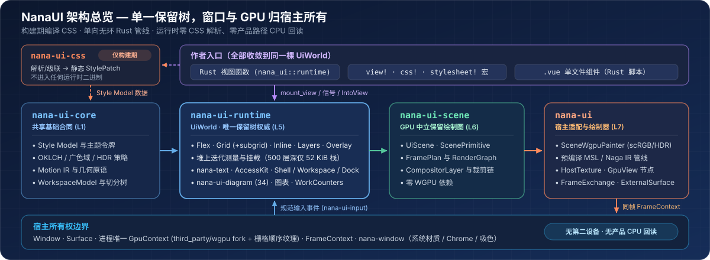

# 介绍

## 什么是 NanaUI？

NanaUI 是一套用来构建原生桌面界面的保留式 Rust 框架。你的应用打开窗口，并持有那块用来绘制的 GPU 设备。框架在一棵界面树上用纯 `Flex + Grid (+ subgrid) + Inline + Layers + Overlay` 模型完成排版、命中与合成，再把这棵树画进窗口的 Surface。

按钮、文字、侧栏和实时画面是同一棵树上的节点。它们共用排版、裁剪、点击和前后顺序。

## 和其他框架的差别

| | 典型做法 | NanaUI |
| --- | --- | --- |
| **网页套壳**（Electron、Tauri、Wry） | 窗口里跑 Chromium / WebView；实时画面是另一个进程或另一套合成 | 无 WebView。界面是同一棵原生树 |
| **游戏引擎 HUD** | 画面是主世界，界面浮在上面 | 画面是树上的节点，和 Button 一样参与布局、裁剪和点击 |
| **即时模式 UI** | 每帧重建界面 | 保留树。无变更不刷帧 |
| **框架自管 GPU 的保留式 UI** | 框架持有 Device；外部画面往往是洞或帧尾贴图 | 宿主持有 Window / Surface / Device / Queue。GPU 内容在文档顺序里 |

相对网页套壳：这里没有 WebView，也没有 JS 运行时。也没有 Tauri 那套窗口、插件和 invoke 协议，也没有浏览器的 CORS、Cookie 和 Service Worker。

相对游戏引擎：界面本身就是主体。实时画面由你画到一张纹理上，再作为普通节点挂到树上。

相对即时模式：控件留在 `UiWorld` 里。没有变化就不刷新这一帧。事件走 `on` / `observe`。跨窗口、GPU 和持久化这类消息，在 `RuntimeProgram::update` 里处理。

相对自己持有 GPU 的保留式界面：NanaUI 用的是你已经有的 Device 和 Queue。实时画面不会先读回 CPU 再贴回去。`SceneWgpuPainter` 在主绘制通道里，按节点顺序采样 `HostTexture`。

## 什么时候用

适合这样的桌面产品：你需要原生窗口的质感，而且着色器、预览视口或其他实时画面必须和面板、对话框待在同一棵界面里。

如果只是把网站放进窗口、只要一块即时模式的调试面板，或者需要完整的浏览器和 Tauri 插件生态，用对应的那类工具。

## 两种写法

Rust 的 `nana_ui::runtime` 是默认的编写方式。`view!` 和函数调用都是这一方式上的一级写法，能力对齐，展开成同一次挂载。侧边栏顶部的开关只切换示例，不改变运行时。

`.vue` 文件是进阶用法，有自己的章节，不在这个开关里。它的脚本也是 Rust，构建时编译成普通视图函数。

路由、每个区域里放什么、配置存在哪里，由你的应用持有。框架提供控件、布局、命中、焦点和绘制。

## 接下来

  <a class="next-step" href="/guide/quick-start">
    
快速开始

    
写出第一段界面。

  </a>
  <a class="next-step" href="/guide/from-vue">
    
从 Vue 过来

    
对照 ref、v-if、v-model 在这里怎么写。

  </a>
  <a class="next-step" href="/guide/essentials/view">
    
视图写法

    
看同一段界面的两种写法如何展开。

  </a>
  <a class="next-step" href="/architecture/">
    
架构

    
看这棵树怎样画到窗口上。

  </a>

