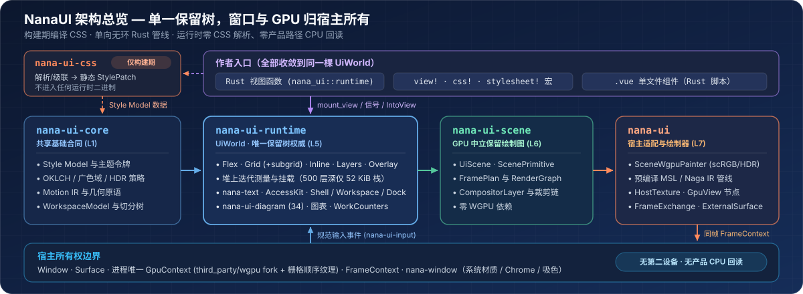

# 架构学习

本板块面向**希望读懂 NanaUI 框架内部实现与设计取舍**的读者：它按模块（全部 25 个 crate：24 个工作区成员与独立 `nana-icons-tabler`）和核心子系统（保留树、布局、样式、文本、Scene 提取、GPU 与帧、输入、窗口、工具链）将整个仓库拆开剖析，并一路下钻到源码级的数据结构与行号锚点。



它与文档站其他板块的分工如下：

| 板块 | 视角与适用读者 |
| --- | --- |
| [指南](/guide/introduction) | 应用开发者入门与进阶：从零搭窗口、响应式、组件组合、热重载、打包与无障碍 |
| [组件](/components/) | 89 个内置控件的目录、用法示例（支持 `view!` / 函数双切换）、属性表与事件表 |
| [架构](/architecture/) | 应用作者需要建立的心智模型（一帧、实时画面、文本、窗口） |
| **架构学习（本板块）** | 面向架构学习者与框架贡献者：全 25 个 crate 覆盖 + 子系统内部下钻 + 端到端数据流 + 核查清单 |
| [参考](/reference/how-it-works) | 面向查阅的完整技术合同（应用 API、声明式视图、CSS/Rust 布局、窗口/GPU/无窗口输出、维护者笔记） |

## 一张图先立住全局主线

```text
Rust / `.vue` 方言输入
    -> nana-ui-core        共享合同：Style Model、主题、几何、Workspace、Motion IR
    -> nana-ui-runtime     UiWorld：保留树、控件、布局、输入、焦点、Shell、Dock、AreaLayout
    -> nana-ui-scene       抽取出的保留绘制图（不依赖 WGPU）
    -> nana-ui             宿主适配器 + SceneWgpuPainter
```

产品渲染路径只有这一条：`UiWorld → ExtractedNode → UiScene → SceneWgpuPainter`。各支撑引擎（CSS 引擎、文本引擎、输入合同、平台与窗口、GPU 合同）在全仓各自只有一处权威实现，详见 [模块与分层](/learn/modules-and-layers) 与 [合同与不变量](/learn/contracts-and-invariants)。

## 章节地图

### 全局视角

| 章节 | 核心内容 |
| --- | --- |
| [模块与分层](/learn/modules-and-layers) | 25 个 crate 的层位分组、58 条工作区成员普通依赖边清单（外加 `nana-icons-tabler → nana-ui-core`）、分层规则与验证命令 |
| [合同与不变量](/learn/contracts-and-invariants) | 九条非协商架构合同：每条配「为什么这样设计」与违反后果 |
| [端到端数据流](/learn/flows) | 四条核心流：状态变更→像素、点击→回调、文字→像素、GPU 实时画面挂树 |
| [代码阅读指南](/learn/reading-the-code) | 仓库地形图、推荐阅读路线、最小可运行示例与调试手段 |

### 基础合同层

| 章节 | 核心内容 |
| --- | --- |
| [核心合同：nana-ui-core](/learn/core-contracts) | Style Model（Tokens + Semantics + Layout）、主题令牌、几何、WorkspaceModel、Motion IR |
| [CSS 引擎：nana-ui-css](/learn/css-engine) | W3C CSS Syntax Level 3 零依赖解析、CSS Cascade 5、直接 `StyleOp` 降维与纯 Rust `StylePatch` 代码生成 |
| [文本引擎：nana-text](/learn/text-engine) | 字体选择 → OpenType 整形 → 保留文本布局三段解耦管线与代际缓存 |

### Runtime 内部

| 章节 | 核心内容 |
| --- | --- |
| [保留树：UiWorld](/learn/runtime-tree) | 稠密节点表与稀疏侧表、原子批式提交、`ComponentRegistry`、三套代际号 |
| [布局引擎：RuntimeLayoutEngine](/learn/runtime-layout) | 格式化上下文、内蕴测量与计划重放、`LayoutFrontier` 依赖图、滚动范围 |
| [输入链路](/learn/runtime-input) | `nana-ui-input` 规范事件、端点合并、`route_input` 唯一路由、焦点、IME 与无障碍投影 |
| [工作台：Shell、Workspace、Dock 与 Overlay](/learn/workspace-shell-dock) | 桌面壳层、区域缩放、Dock 递归树、AreaLayout、浮层同事务焦点迁移与状态持久化 |

### 渲染与宿主面

| 章节 | 核心内容 |
| --- | --- |
| [Scene 提取](/learn/scene-extraction) | `UiScene` 绘制图结构、`apply_delta` 增量失效、`FramePlan` 编译、为何不依赖 WGPU |
| [GPU 与帧生命周期](/learn/gpu-frame) | `nana-gpu` 合同、提交顺序、帧槽、上传环、`SceneWgpuPainter`、一帧 35 步全序 |
| [窗口与平台](/learn/window-platform) | `nana-ui-platform` 中立合同、`nana-window` 原生执行、材质回退语义、无头 `WebSurface` |

### 作者入口与工具链

| 章节 | 核心内容 |
| --- | --- |
| [作者入口](/learn/authoring-paths) | Rust `view!` 宏链与 `.vue` 方言如何汇入同一棵 `UiWorld` |
| [作者工具链](/learn/toolchain) | `view-macros` / `view-schema` / `view-codegen`、`.vue` SFC 编译器 |
| [外围支撑 crate 一览](/learn/supporting-crates) | 图表、诊断、SVG 栅格化、图标、打包读写两侧、热重载、devtools 及周边生态 |

### 附录

| 章节 | 核心内容 |
| --- | --- |
| [25 crate 覆盖矩阵](/learn/coverage-matrix) | 每个 crate 的职责、依赖方向、关键入口类型与归属章节四要素速查 |
| [证据清单](/learn/evidence-checklist) | 关键架构断言的只读核查命令、当前工作区实跑读数与源码行号锚点 |

## 25 个 Crate 的章节归属

| Crate | 归属章节 |
| --- | --- |
| `nana-ui-core` | [核心合同](/learn/core-contracts) |
| `nana-ui-css` | [CSS 引擎](/learn/css-engine) |
| `nana-text` | [文本引擎](/learn/text-engine) |
| `nana-ui-runtime` | [保留树](/learn/runtime-tree) · [布局引擎](/learn/runtime-layout) · [输入链路](/learn/runtime-input) · [工作台层](/learn/workspace-shell-dock) |
| `nana-ui-input` | [输入链路](/learn/runtime-input) |
| `nana-ui-scene` | [Scene 提取](/learn/scene-extraction) |
| `nana-gpu` | [GPU 与帧生命周期](/learn/gpu-frame) |
| `nana-frame-exchange` | [GPU 与帧生命周期](/learn/gpu-frame) |
| `nana-ui` | [GPU 与帧生命周期](/learn/gpu-frame) · [作者入口](/learn/authoring-paths) |
| `nana-ui-platform` | [窗口与平台](/learn/window-platform) |
| `nana-window` | [窗口与平台](/learn/window-platform) |
| `nana-ui-sfc` | [作者工具链](/learn/toolchain) |
| `nana-ui-view-macros` | [作者工具链](/learn/toolchain) |
| `nana-ui-view-schema` | [作者工具链](/learn/toolchain) |
| `nana-ui-view-codegen` | [作者工具链](/learn/toolchain) |
| `nana-ui-charts` | [外围支撑 crate 一览](/learn/supporting-crates) |
| `nana-ui-diagram` | [外围支撑 crate 一览](/learn/supporting-crates) |
| `nana-diagnostics` | [外围支撑 crate 一览](/learn/supporting-crates) |
| `nana-svg-raster` | [外围支撑 crate 一览](/learn/supporting-crates) |
| `nana-app-icon` | [外围支撑 crate 一览](/learn/supporting-crates) |
| `nana-icons-tabler` | [外围支撑 crate 一览](/learn/supporting-crates) |
| `nana-package` | [外围支撑 crate 一览](/learn/supporting-crates) |
| `nana-packager` | [外围支撑 crate 一览](/learn/supporting-crates) |
| `nana-ui-dev` | [外围支撑 crate 一览](/learn/supporting-crates) |
| `nana-ui-devtools` | [外围支撑 crate 一览](/learn/supporting-crates) |

## 三条推荐阅读路线

- **从全局鸟瞰入手**：[模块与分层](/learn/modules-and-layers) → [合同与不变量](/learn/contracts-and-invariants) → 挑感兴趣的子系统章节 → [端到端数据流](/learn/flows)。
- **从一帧的渲染入手**：[端到端数据流](/learn/flows)（流程一：状态→像素）→ [保留树](/learn/runtime-tree) → [Scene 提取](/learn/scene-extraction) → [GPU 与帧生命周期](/learn/gpu-frame)。
- **从特定 Crate 入手**：在 [25 crate 覆盖矩阵](/learn/coverage-matrix) 中查到它的职责与关键入口类型，跳到归属主章，再沿数据流查看它的上下游协作。
