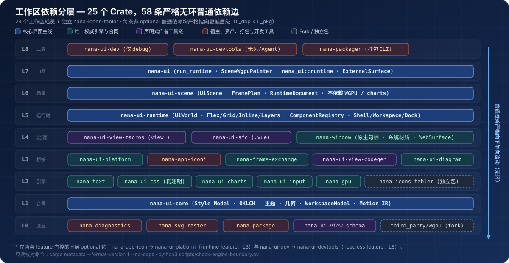

# 模块与分层

本章回答三个基础问题：**`crates/` 下 25 个 crate（24 个工作区成员 + 独立 `nana-icons-tabler`）各自处于哪一层**、**依赖边如何单向流动**，以及**如何用一条命令亲手验证分层结论**。读完后你应能在脑中画出整个仓库的依赖地图，并能立即判断「某条新依赖该不该加」。

分层在 NanaUI 中不是形式主义，而是用编译期可见性守住三条底线：**只有一棵权威保留树**、**每个支撑引擎只有一处实现**、**核心树与场景对图形后端中立**。一旦依赖方向倒置，第二套权威就会随之滋生。

## 核心结论

`crates/` 下 25 个 crate 的普通依赖（normal dependencies）全部沿「上层 → 下层」单向流动，**严格无环**。产品渲染主线分为四层：

```text
nana-ui-core → nana-ui-runtime → nana-ui-scene → nana-ui
  共享合同         保留树权威         保留绘制图      宿主适配 + SceneWgpuPainter
```

- `nana-ui-core` 的依赖表中没有 `runtime`、`scene` 或 `nana-ui`；
- `nana-ui-scene` 的依赖表中没有 `nana-ui`、`nana-ui-charts`，也没有任何 GPU crate；
- 整张依赖图拓扑排序成功，不存在任何环路。

仅用于单元测试与基准测试的 `dev-dependencies` 有少量「向上」指向宿主层的边，已单独列在文末的 [dev 边与例外](#dev-边与例外)，不参与产品二进制分层。

## 如何用命令验证

全部分层读数来自在工作区根目录执行的一条标准命令：

```bash
cargo metadata --format-version 1
```

输出中的 `resolve.nodes` 与包清单列出了每个包声明和解析出的依赖及 `dep_kinds`（可精确区分 `normal`、`dev` 与 `build`）。过滤出 24 个工作区成员指向 `crates/` 内路径包的 `normal` 依赖边，即可得到全仓 **58 条工作区成员普通依赖边**（24 个工作区成员之间 57 条 + `nana-ui → nana-icons-tabler` 可选边 1 条；另加非成员 `nana-icons-tabler → nana-ui-core` 1 条）。

## 依赖层级总表（Level 0 → Level 8）



下表按依赖深度归组排布，满足一条严格的不变量：**每一条非 optional 的普通依赖边都指向层级号更小的 crate**。仅有的两条同层依赖均为 feature 门控的 optional 依赖：`nana-app-icon → nana-ui-platform`（第 3 层，`runtime` feature，`crates/nana-app-icon/Cargo.toml:14,22`）与 `nana-ui-dev → nana-ui-devtools`（第 8 层，`headless` feature，`crates/nana-ui-dev/Cargo.toml:20,36`）。

| 层级 | Crate | 工作区内直接依赖（normal） | 核心角色 |
| --- | --- | --- | --- |
| 0 | `nana-diagnostics` | — | 框架诊断底座：`event!` / `metric!` / `fault!` / `span!` |
| 0 | `nana-svg-raster` | — | CPU 侧 SVG 栅格化工具 |
| 0 | `nana-package` | — | 资源包（`.nrpack`）与清单的运行时只读模型 |
| 0 | `nana-ui-view-schema` | — | 声明式视图内置控件的唯一 schema 表 |
| 1 | `nana-ui-core` | `nana-diagnostics` | 共享基础合同：Style Model、主题、几何、WorkspaceModel、Motion IR、`WorkCounters` |
| 2 | `nana-text` | `nana-ui-core` | 文本测量、OpenType 整形、字形定位/可选光栅化与保留文本布局（产品唯一排版权威） |
| 2 | `nana-ui-css` | `nana-ui-core` | CSS 解析、选择器匹配与级联的唯一实现 |
| 2 | `nana-ui-charts` | `nana-ui-core` | 图表模型、刻度与 GPU 标记数组 |
| 2 | `nana-ui-input` | `nana-ui-core`, `nana-diagnostics` | 规范输入事件、序列器、有界端点与 `HostServices` |
| 2 | `nana-gpu` | `nana-diagnostics` | GPU 后端合同：`GpuContext` / `FrameContext` / `GpuTexture` |
| 2（独立） | `nana-icons-tabler` | `nana-ui-core`（path 依赖，非 workspace member） | 自动生成的 Tabler 矢量图标常量目录 |
| 3 | `nana-ui-platform` | `nana-ui-core`, `nana-ui-input`, `nana-diagnostics` | 平台中立窗口、路径规范化与屏幕取色合同（并再导出输入合同） |
| 3 | `nana-app-icon` | `nana-ui-platform`（optional，`runtime` feature） | 应用默认图标与三平台图标编码 |
| 3 | `nana-frame-exchange` | `nana-gpu` | 跨线程有界最新帧交换池 |
| 3 | `nana-ui-view-codegen` | `nana-ui-core`, `nana-ui-css`, `nana-ui-view-schema` | `view!` 与 `.vue` 的代码生成器（构建时调用 CSS 引擎） |
| 3 | `nana-ui-diagram` | `nana-ui-core`, `nana-ui-charts` | 原生 Mermaid 图表引擎：34 种图表家族（`DiagramKind::ALL`）解析、分层布局与主题无关矢量显示列表 |
| 4 | `nana-window` | `nana-ui-core`, `nana-ui-platform` | 原生窗口句柄、系统材质、客户区 chrome、缩放、辅助父子窗口、WebSurface |
| 4 | `nana-ui-view-macros` | `nana-ui-view-codegen` | `view!` / `css!` / `stylesheet!` 过程宏 |
| 4 | `nana-ui-sfc` | `nana-ui-view-codegen` | `.vue` 单文件组件（Rust 脚本）构建期编译器 |
| 5 | `nana-ui-runtime` | `nana-diagnostics`, `nana-ui-core`, `nana-text`, `nana-ui-input`, `nana-ui-view-schema`，可选 `nana-ui-charts` / `nana-ui-diagram` / `nana-ui-view-macros` | **`UiWorld` 保留树权威**、内置控件、纯五上下文布局引擎、输入路由、Shell/Dock/AreaLayout |
| 6 | `nana-ui-scene` | `nana-diagnostics`, `nana-ui-core`, `nana-ui-runtime`，可选 `nana-text`（benchmark） | `UiScene` 保留绘制图与 `FramePlan`（无 WGPU、无图表模型依赖） |
| 7 | `nana-ui` | 必选：`nana-diagnostics`, `nana-text`, `nana-ui-core`, `nana-ui-platform`, `nana-ui-runtime`, `nana-ui-scene`；可选：`nana-app-icon`, `nana-frame-exchange`, `nana-gpu`, `nana-icons-tabler`, `nana-package`, `nana-svg-raster`, `nana-ui-charts`, `nana-window` | 宿主适配器、`SceneWgpuPainter`、`run_runtime`（`default = []`） |
| 8 | `nana-packager` | `nana-app-icon`, `nana-package` | 应用打包与防篡改校验 CLI |
| 8 | `nana-ui-dev` | `nana-ui`, `nana-ui-core`，可选 `nana-ui-devtools` / `nana-ui-sfc` | 开发期热重载工具（仅限 debug 构建） |
| 8 | `nana-ui-devtools` | `nana-ui-core`，可选 `nana-gpu` / `nana-ui` / `nana-ui-platform` / `nana-ui-scene` | 开发期结构化诊断记录与无头 Agent 会话 |

::: tip 层级号代表依赖深度，而非“重要程度”
`nana-ui-core` 位于第 1 层，却是全框架最核心的数据合同；层级号越大，代表它越靠近宿主组装层与应用入口。
:::

## 按职能分为五大板块

1. **产品渲染主线（一帧的骨架）**：`输入（Rust / `.vue` 方言） → nana-ui-core → nana-ui-runtime → nana-ui-scene → nana-ui → 宿主 Surface`。
2. **支撑引擎与领域模型（各自唯一权威）**：
   - 文本引擎：`nana-text`（被 `runtime` 测量、`nana-ui` 绘制与光栅化）；
   - CSS 引擎：`nana-ui-css`（仅被构建期的 `view-codegen` 消费，`runtime`、`scene` 与 `nana-ui` 均不依赖它）；
   - 图表模型：`nana-ui-charts`（被 `runtime`、`diagram` 与 `nana-ui` 管线消费，`scene` 不再依赖它）；
   - Mermaid 图表引擎：`nana-ui-diagram`（纯 CPU 解析/布局/矢量显示列表，被 `runtime` 的 `rich-text` 按 feature 启用消费）；
   - 输入合同：`nana-ui-input`（经 `platform` 再导出，由 `runtime` 唯一消费路由）；
   - GPU 合同：`nana-gpu`（被 `nana-ui`、`frame-exchange`、`devtools` 消费）；
   - 原生窗口：`nana-window`（在第 4 层基于 `core` 与 `platform` 实现，仅被 `nana-ui` 宿主层调用）。
3. **声明式视图编译工具链**：`nana-ui-view-schema` → `nana-ui-view-codegen` → `nana-ui-view-macros` 与 `nana-ui-sfc`（详见 [作者工具链](/learn/toolchain)）。
4. **资产、图标与打包分发**：`nana-svg-raster`、`nana-app-icon`、`nana-icons-tabler`、`nana-package`（运行时读侧）、`nana-packager`（构建期写侧）。
5. **开发期与自动化验证工具**：`nana-ui-dev`（热重载）、`nana-ui-devtools`（无头 Agent 会话与像素/语义快照）。

## 58 条工作区成员普通依赖边完整清单

```text
nana-diagnostics     → （零工作区依赖）
nana-svg-raster      → （零工作区依赖）
nana-package         → （零工作区依赖）
nana-ui-view-schema  → （零工作区依赖）
nana-icons-tabler    → nana-ui-core（非 member 的 path 依赖，不计入 24 成员起点的 58 条边；由链接器按引用裁剪）
nana-ui-core         → nana-diagnostics
nana-text            → nana-ui-core
nana-ui-css          → nana-ui-core
nana-ui-charts       → nana-ui-core
nana-ui-input        → nana-ui-core, nana-diagnostics
nana-gpu             → nana-diagnostics
nana-ui-platform     → nana-ui-core, nana-ui-input, nana-diagnostics
nana-app-icon        → nana-ui-platform（optional，feature `runtime`）
nana-frame-exchange  → nana-gpu
nana-ui-view-codegen → nana-ui-core, nana-ui-css, nana-ui-view-schema
nana-ui-diagram      → nana-ui-core, nana-ui-charts
nana-window          → nana-ui-core, nana-ui-platform
nana-ui-view-macros  → nana-ui-view-codegen
nana-ui-sfc          → nana-ui-view-codegen
nana-ui-runtime      → nana-diagnostics, nana-ui-core, nana-text, nana-ui-input, nana-ui-view-schema,
                       nana-ui-charts (optional), nana-ui-diagram (optional), nana-ui-view-macros (optional)
nana-ui-scene        → nana-diagnostics, nana-ui-core, nana-ui-runtime,
                       nana-text（benchmark feature，optional）
nana-ui              → nana-diagnostics, nana-text, nana-ui-core, nana-ui-platform, nana-ui-runtime, nana-ui-scene,
                       nana-app-icon (optional), nana-frame-exchange (optional), nana-gpu (optional),
                       nana-icons-tabler (optional), nana-package (optional), nana-svg-raster (optional),
                       nana-ui-charts (optional), nana-window (optional)
nana-packager        → nana-app-icon, nana-package
nana-ui-dev          → nana-ui, nana-ui-core, nana-ui-devtools（optional，feature `headless`）,
                       nana-ui-sfc（optional，feature `templates`）
nana-ui-devtools     → nana-ui-core, nana-gpu (optional), nana-ui (optional),
                       nana-ui-platform (optional), nana-ui-scene (optional)
```

## dev 边与例外

以下 `dev-dependencies` 仅服务于各 crate 自身的集成测试与基准测试，不会进入任何产品构建产物：

```text
nana-text           → nana-ui-core（dev，bundled-fonts 测试语料）
nana-ui-scene       → nana-text, nana-ui-core, nana-ui-input（dev，构造基准与场景测试）
nana-packager       → nana-ui-platform（dev）
nana-ui-dev         → nana-ui-platform, nana-ui-runtime, nana-ui-scene（dev）
```

## 给学习者的三条判断法则

1. **想找某件事的权威实现，先看依赖表**：`nana-ui-runtime` 依赖 `nana-text` 而非相反，说明文本排版权威在 `nana-text`；`nana-ui` 位于第 7 层依赖各子系统，说明它是宿主组装层而非树或样式权威。
2. **反向依赖等于滋生第二套权威**：如果哪天 `nana-ui-core` 依赖了 `nana-ui-runtime`，基础合同层就会耦合保留树的内部结构，分层屏障随之失效。
3. **一个 crate 所处的层级决定了它的视野**：第 2 层的 `nana-ui-css` 看不见树和窗口，因此不可能在 CSS 引擎里偷偷测量容器；第 6 层的 `nana-ui-scene` 看不见 `nana-gpu`，因此绘制图天然与 WGPU 解耦。

## 接着读

- [合同与不变量](/learn/contracts-and-invariants)：分层所守护的九条核心架构合同
- [25 crate 覆盖矩阵](/learn/coverage-matrix)：每个 crate 的关键入口类型与源码锚点速查
- [架构合同（参考）](/reference/architecture)：面向维护者的边界合同全文
