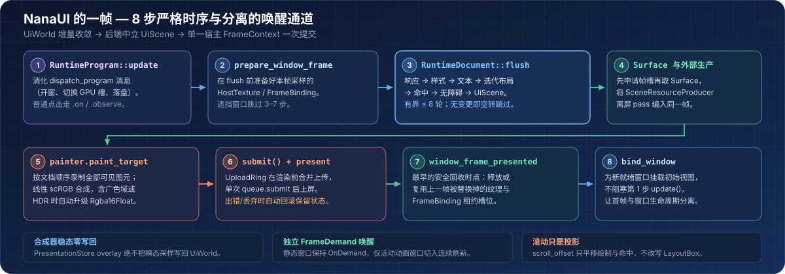

# 框架如何运行

本文建立 NanaUI 的核心运行模型。读完后你应能清楚判断三件事：**业务状态放在哪里**、**一帧之内各层按什么顺序协作**，以及**实时 GPU 画面如何作为普通节点融进界面树**。

具体函数签名见 [应用 API](application-api.md)，保留树与绘制图的底层提取细节见 [Runtime 与 Scene](runtime-scene.md)。

## 三个核心事实

1. **界面是一棵保留树（Retained Tree）。** `Text`、`Button`、侧栏、对话框以及实时 GPU 画面都是树上的节点。框架负责维护这棵树并完成布局、命中测试、焦点管理与绘制，应用从不手写控件的像素坐标。
2. **窗口与 GPU 归宿主（你的应用）所有。** 应用持有 `Window`、`Surface`、`Device` 和 `Queue`（由 `run_runtime` 托管的默认宿主同样遵循这一所有权）。NanaUI 只往宿主的帧里录制绘制命令：既不创建第二套 GPU 设备，也不把画面读回 CPU 再贴回 GPU。
3. **实时画面是一等树节点。** 着色器输出或预览视口既不是窗口上挖出的“洞”，也不是盖在界面顶上的 HUD 浮层——它像 `Button` 一样占据布局尺寸、受父容器裁剪、可被后续节点遮挡、按同一套命中规则接收点击，合成顺序严格遵循文档顺序（document order）。

## 职责与所有权边界

```text
应用（Application）
  ├─ 业务状态、配置存储、鉴权与导航路由
  ├─ 每个 Region / Dock 窗格 / AreaLayout 区域内展示的具体内容
  ├─ 当前帧着色器或视口渲染到哪张纹理
  └─ 窗口与 Dock 布局恢复：可由应用自管，或通过 persist_key 交给框架的 ViewStateStore（物理后端由宿主注入）

NanaUI（Runtime + Scene + Painter）
  ├─ 控件语义、组装与交互状态
  ├─ 布局求解、滚动、命中测试、焦点链、IME 与无障碍增量投影
  └─ 将脏节点抽取为 UiScene，并由 SceneWgpuPainter 画进宿主的 Surface

nana-window（平台原生边界）
  ├─ 系统材质（Vibrancy / Mica / Acrylic）、标题栏拖拽与客户区 chrome
  └─ 隔离原始窗口句柄（HWND / NSWindow），普通控件永远拿不到原生句柄
```

`Workspace`、`Dock`、`AreaLayout` 与 `Settings` 提供桌面壳层的可复用骨架（区域、分隔条、折叠、页签），而每个区域里放什么文档、资源列表或预览视口，始终由你的应用决定。

## 应用如何接入这棵树

普通 Rust 应用通常实现高层的 `ApplicationState`，并通过 `RuntimeApplication<State>` 调用 `run_runtime`——容器会自动管理文档路由、GPU 注册表与窗口生命周期（完整最小示例见 `crates/nana-ui/examples/application-counter.rs`）。

需要精细控制多窗口或嵌入式事件循环的宿主，则直接实现底层的 `RuntimeProgram`：

```text
initialize                   创建 RuntimeDocument 并挂载初始视图树
with_document / with_document_mut
                             按 WindowId 在闭包中向宿主借出对应的 RuntimeDocument
update                       仅处理宿主级消息（开窗、切换 GPU 资源、持久化）
                             —— 按钮点击等控件交互请直接用 .on / .observe，不要绕道 update
host_textures / prepare_window_frame / window_frame_presented
                             默认 GPU 路径：将可采样纹理挂上树，flush 前更新，present 后回收旧纹理
scene_gpu_renderers / scene_resource_producers
                             高级 GPU 路径：同 pass 直写或按图离屏生产（首次接入可忽略，见 gpu.md）
```

控件交互直接绑定在视图节点上（如 `.on_activate(...)` 或 `AppContext::on`）。只有在需要开窗、换纹理等跨宿主操作时，才在事件回调里调用 `cx.dispatch_program(Message)`，交由下一帧开头的 `update` 处理。`update` 应保持轻量；填充新窗口内容等操作放在 `present` 之后的 `bind_window` 中执行。完整可运行代码见 [创建应用](../guide/essentials/application.md)。

## 一帧的执行顺序



在 `run_runtime`（底层为 `run_runtime_scene`）中，每一扇需要重绘的窗口按以下 8 步顺序推进：

```text
1. 消化 dispatch_program 消息  → RuntimeProgram::update
2. prepare_window_frame        → 应用准备好本帧要采样的最新纹理
3. RuntimeDocument::flush      → 样式、文本整形、布局、命中索引、无障碍与 Scene 增量抽取
4. 获取 Surface + 外部资源生产  → 编译 FramePlan，共用同一宿主 encoder（失败则整帧丢弃并回滚）
5. SceneWgpuPainter::paint_target → 按文档顺序将可见图元录制进目标
6. queue.submit + present      → 每个目标一次提交并上屏
7. window_frame_presented      → 此时才可安全释放上一帧退役的纹理
8. bind_window                 → 按需为新就绪窗口绑定后续内容
```

- **无变更不空刷**：当树没有变化时，`flush` 是微秒级空转，宿主不会空刷帧。静态窗口保持 `FrameDemand::OnDemand`。
- **唤醒通道分离**：动画、实时 GPU 画面与普通 UI 变更的唤醒彼此独立。一块实时纹理更新（通过 `HostTextureRegistry::slot` 返回的 `TextureSlot` 通知引用它的窗口）或一条合成器动画推进，不会迫使整棵 `UiWorld` 重新跑样式与布局。窗口在自己这一帧的 `prepare_window_frame` 里把生产者的新帧绑进槽位时，这次槽位通知由正在画的这一帧消化，一帧生产者画面只呈现一次；开始编码之后才换的槽位照常再唤醒一次。
- **遮挡与零尺寸窗口**：当窗口被最小化、遮挡或尺寸为 0 时，宿主仍按程序声明的 `FrameDemand` 调用 `prepare_window_frame`（当尺寸可画时仍编码离屏 producer），但跳过 UI `flush`、不获取 Surface、不 `present`，也不调用 `window_frame_presented`。
- **应用不手写布局**：`flush` 内部统一调用宿主的 `NanaTextShaper` 与 `RuntimeLayoutEngine`，应用切勿自行跑第二套布局或往树里硬塞像素坐标。对外公开身份只有 `DocumentId`、`StableNodeId` 和类型化的 `Entity<V>`。

## 动画与呈现分离（Motion IR）

动画意图统一编译进 `nana-ui-core::motion`（Motion IR）。无论 Rust L3 的 `node.transition()`、`Spring::to`、`Timeline::parallel / sequence`，还是 CSS 的 `transition`，最终都落到同一套轨道表示上：

- **逻辑值与呈现值分离**：`UiWorld` 保存的是逻辑目标状态；过渡途中的瞬时值保存在 `PresentationStore` 的 overlay 中，按「节点 + 属性」在给定时间戳下确定性求值（spring 与 decay 均按绝对时间求解析解，不依赖上一帧积分）。L3 transition 结束后会保持终点值，直到该属性下一次被写入不同的逻辑值。
- **节点自己的轨道**：每个节点的每个属性有一条自己的轨道，`node.transition()` 和视图层的进出场过渡都跑在上面，ID 是 `AnimationId::for_node(node, property)`（动画事件里带的也是它）。`node.transition()` 从当前呈现值出发；要从指定值出发、替换这条轨道上正在跑的动画、首尾都保持（`fill: both`），用 `AnimationSpec::run(node, property, from, to, now, duration)`，再用 `with_curve` / `with_delay` 等调整，交给 `MutationQueue::start_animation`。应用不必自己拼 `AnimationSpec` 或给动画 ID 加盐。
- **列表重排（FLIP）**：通过显式的呈现变换 `node.flip(first, last)` 完成——逻辑布局盒直接停在终点（Last），视觉从反向偏移（Invert）平滑回到单位变换。
- **合成器稳态零写回**：`Compositor` 类轨道的 `MotionDescriptor` 只在启动、改目标（retarget）或取消时写入代际表（generational slab）；稳态帧只推进时间 uniform，`SceneWgpuPainter` 在 Quad 着色器的 `evaluate()` 中直接求值（非 Quad 图元仍读取 CPU overlay），产品 `present` 路径绝不回读 GPU。
- **按需连续刷新**：CPU 与 Layout 动画通过稀疏的 `next_animation_deadline` 调度；`UiScene::compositor_needs_tick` 仅将当前窗口切入轻量的 `FrameDemand::Continuous` 呈现，不触发 `UiWorld` 样式或布局重算。窗口最小化或被遮挡时不追赶隐藏的 GPU 帧，恢复可见后按绝对时间直接求值；设备或 Surface 重建后由宿主调用 `UiScene::set_surface_generation`。

各属性的默认动画分类由 `AnimatableProperty::animation_class()` 决定，组件不可覆盖：

| 属性 | 默认分类 | 执行路径 | 回退与性能边界 |
| --- | --- | --- | --- |
| `transform` / `opacity` | `Compositor` | 呈现 overlay；Quad 走 GPU `evaluate()`，非 Quad 走 CPU overlay | 稳态不写 `UiWorld`；文本/图标/Mesh/HostTexture 仍走 CPU overlay |
| `clip` / `clip-path` | `Compositor` | 呈现 overlay（着色器当前仅绑定 transform / opacity 的 `motion_id`） | 稳态不写 `UiWorld`；裁剪呈现走 CPU overlay |
| `shader-parameter` | `Compositor` | 呈现 overlay（需注册类型化编解码器） | 无默认 Quad GPU 路径 |
| `color` / `background` / `blur` / `filter` / `shadow` | `Paint` | CPU 稀疏采样插值 | 每次采样标脏 paint / extract；无 GPU 滤镜轨道 |
| `width` / `height` / `padding` / `margin` | `Layout` | CPU 布局求值 | 每次采样触发局部布局；严禁用 `scale` 伪造尺寸变化 |
| `font-size` / `font-axis` | `Layout` | 逐轴轨道叠入计算样式的 `font_variations`，触发 `nana-text` 重新整形 | 每个变化的采样都是真实字形变体，不退化为几何缩放 |
| `display` | `Discrete` | 离散跳变（snap） | 不做插值 |

## 实时画面如何挂入树中

默认产品路径是将实时画面渲染到可采样纹理，在树上挂载 `GpuTextureView`，并使用**同一个字符串槽位名**在 `host_textures()` 中登记。多层画面只需挂载相邻的多张 `GpuTextureView`；`Video` 同样走 `video:{id}` 宿主纹理槽（有槽位时不叠加 poster）。更换纹理尺寸或对象时递增 `generation` 即可，切勿销毁重建 Runtime 节点。

只有在完全没有中间纹理、必须直接画进当前 UI 渲染通道时，才使用 `GpuView`（以 `u64` 槽位号匹配已注册的 `SceneGpuRenderer`，不同于 `HostTextureRegistry` 的字符串键）。详细接入规范见 [实时画面](gpu.md)。

## 一份 Style Model，一棵树

```text
Rust 声明式视图 / create_component ──┐
.vue 方言（构建期编译成 Rust）      ─┴─► Style Model ─► UiWorld ─► UiScene ─► SceneWgpuPainter
```

Rust 控件、`view!` 与 `.vue` 方言写出的界面，全部写入同一套 Style Model（Tokens + Semantics + Layout）并汇入同一棵 `UiWorld`。全框架只有一个 CSS 引擎 `nana-ui-css`：`.vue` 编译器、Rust `view!` 的 `<style>`、`stylesheet!` 与 `css!` 在构建时调用它并编译为 Style Model 补丁数据。

NanaUI **没有整窗 WebView 壳**。若业务确实需要在窗口局部嵌入真实网页，只能使用显式的宿主原生例外 `runtime::BrowserView`（Runtime 节点负责布局、无障碍与生命周期，宿主管理原生 `WKWebView` 子视图，当前仅支持 macOS，且不进入离屏截图）。

## 非协商红线（不要做的事）

以下条款是框架架构合同，而非编码风格建议：

- **禁止创建第二套 `Device` / `Queue`**，或让实时内容在另一条独立队列上提交却期望与 UI 帧严格对齐。
- **禁止产品路径 CPU 回读**：不要把 GPU 画面拷回 CPU、编码成图片再塞回界面树。
- **禁止帧尾盖层**：不要在 UI 绘制完成后再往窗口 Surface 上强行盖一层实时画面或原生 WebView。
- **禁止控件触碰原生窗口句柄**：普通控件绝不直接调用平台窗口 API。
- **禁止使用已废弃的根路径导出**：新代码统一从 `nana_ui::runtime` 导入控件；产品级停靠使用 Runtime 的 `Dock` 与 `DockWorkspace`（`nana_ui::dock::*` 仅是宿主适配器）。
